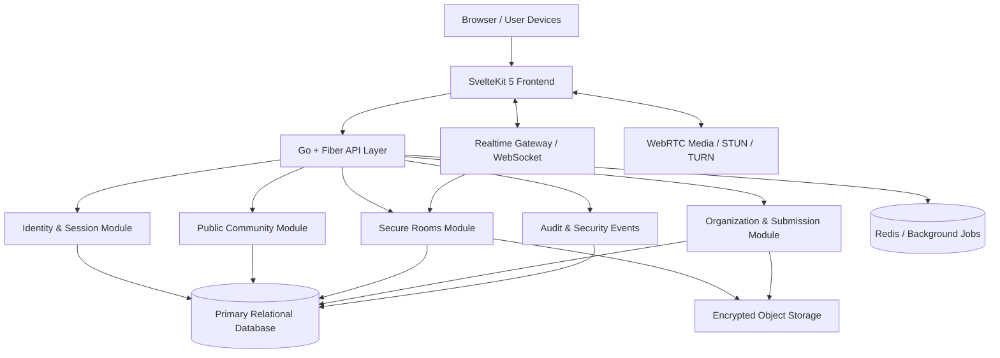
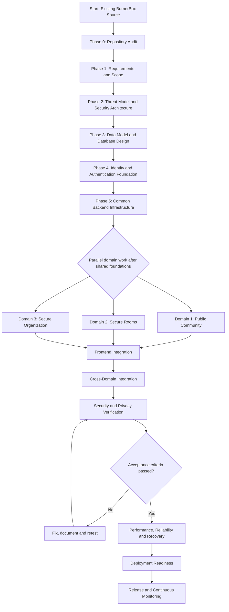
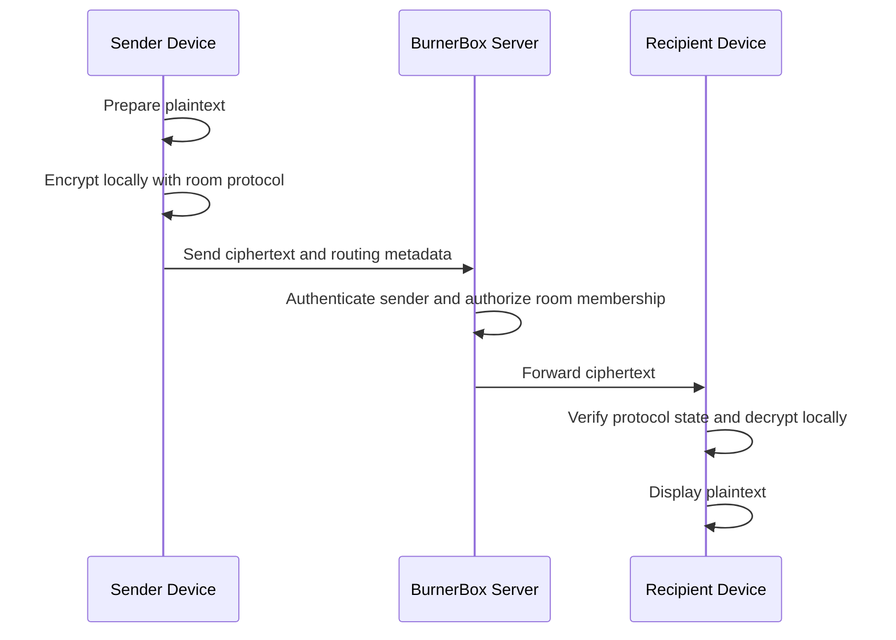
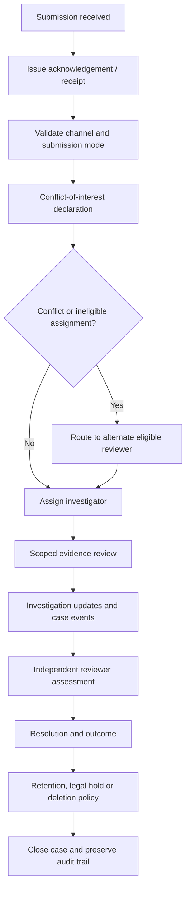
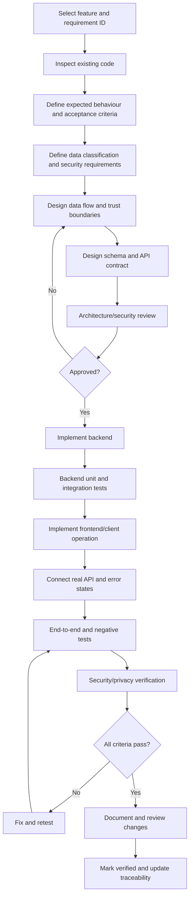

# BurnerBox — Master Project Blueprint and Development Source of Truth

**Document type:** Product, architecture, security, implementation and delivery blueprint  
**Version:** 1.0 (planning baseline)  
**Prepared:** 19 November 2026  
**Project:** BurnerBox  
**Status:** Proposed target architecture; not a statement that every listed capability is already implemented or security-verified.

> This document consolidates the project direction, approved product decisions, proposed architecture, workflows, implementation phases, testing requirements and release gates. It is the planning source of truth until a decision is explicitly changed through the decision log. Existing code must be audited before any implementation is assumed complete.

---

## 1. Product vision

BurnerBox is a privacy-first platform combining three deliberately separated security domains:

1. **Public Community** — public or restricted discussions with pseudonymous and anonymous participation, community moderation and controlled identity-review requests.
2. **Secure Rooms** — private communication with end-to-end encrypted (E2EE) messages, encrypted file sharing, owner-selected persistence and optional small-group audio/video.
3. **Secure Organization** — confidential whistleblower submissions, evidence handling, organizational access control, investigations and carefully governed identity-review workflows.

The goal is not to make one generic application where every administrator can access everything. The goal is one product with distinct trust boundaries, explicit data ownership, domain-specific authorization and documented privacy guarantees.

### 1.1 Product principles

- Privacy and security are architectural requirements, not cosmetic features.
- The server must not receive plaintext E2EE room messages or recipient-encrypted submission content.
- Public community content may be server-readable for delivery, search and moderation; this must be disclosed accurately.
- Anonymous, pseudonymous, guest and account-backed identities are different modes and must not be conflated.
- Identity disclosure must never be a routine moderator action.
- Organization tenancy and room membership must be enforced server-side on every sensitive request.
- Use established cryptographic protocols and maintained libraries; do not invent cryptographic primitives.
- Prefer secure failure: an authorization, key, or policy failure must not silently grant access.
- Retention, deletion, backups and recipient-held copies must be described honestly.
- A feature is complete only after implementation, tests, security review and documentation.

### 1.2 Product scope boundaries

BurnerBox is not intended to promise absolute anonymity, immunity from compromised endpoints, untraceable network traffic, or deletion of copies already downloaded by recipients. Tor access, metadata reduction, E2EE and anonymous credentials address different threat classes and must not be represented as interchangeable guarantees.

---

## 2. Current source baseline and audit-first rule

The supplied source archive is the starting point. It appears to contain a Go/Fiber backend, SvelteKit 5 frontend, existing room and submission routes, cryptographic utilities, authentication/session functionality, tests, documentation, database drivers and local upload data. The root README currently describes SQLite/Turso, while the backend module includes PostgreSQL and SQLite drivers. This discrepancy must be resolved by repository inspection before choosing the production database configuration.

### 2.1 Evidence labels used throughout this plan

| Label | Meaning |
|---|---|
| Existing — verify | A related implementation appears in the supplied source; functionality and security are not yet certified. |
| Approved | Product direction accepted for planned implementation. |
| Proposed | Recommended technical approach requiring design review. |
| Undecided | Requires an explicit decision before implementation. |
| Deferred | Intentionally outside the first delivery milestone. |
| Complete | Only allowed after acceptance criteria and tests pass. |

Do not change an item to **Complete** merely because a route, component, database table or prototype exists.

### 2.2 Phase 0 — repository audit checklist

1. Extract a clean working copy and inventory all tracked and untracked files.
2. Identify all frontend routes, layouts, components, stores and API clients.
3. Inventory backend packages, handlers, middleware, services and background workers.
4. Map every HTTP route, method, request schema, response schema and authorization rule.
5. Inspect database models, migrations, constraints, indexes and database configuration.
6. Identify whether SQLite, PostgreSQL or both are actually supported and how the active driver is selected.
7. Inspect registration, login, MFA, password recovery, session expiry, logout and device/session revocation.
8. Inspect authorization at handler and data-access layers; test object ownership and tenant isolation.
9. Review all cryptographic operations, key derivation, key storage, nonce handling, signatures, random generation and versioning.
10. Review room creation, invitation, membership, WebSocket authentication, revocation and room expiry.
11. Review submission creation, acknowledgement, recipient encryption, controlled submission and evidence access.
12. Review upload validation, malware scanning, metadata handling, storage paths, download authorization and deletion.
13. Inspect audit logs, receipts, integrity proofs, timestamp assumptions and verification tools.
14. Run existing backend and frontend tests; record commands, environment, failures and skipped tests.
15. Run static analysis, dependency checks and secret scanning where available.
16. Identify generated files, local databases, private uploads, environment files and credentials.
17. Produce a feature-to-code traceability matrix and classify each capability using the evidence labels above.
18. Produce a prioritized vulnerability and technical-debt register.

**Phase 0 deliverables:** repository map, frontend route inventory, API inventory, database inventory, authentication/authorization review, cryptography review, storage review, test baseline, security findings, feature matrix and refactoring plan.

**Exit gate:** the team can explain what exists, where it exists, what is verified, what is incomplete and what must be redesigned. No large feature implementation begins before this gate.

---

## 3. High-level architecture

### 3.1 Initial deployment shape

Use a **modular monolith** initially: one backend deployment with strongly separated internal modules, packages, service interfaces and authorization policies. This avoids premature microservice complexity while preserving boundaries that could later be extracted.

### 3.2 Domain separation

- **Public Community:** server-readable public content, pseudonymous display identities, moderation records and community policies.
- **Secure Rooms:** ciphertext routing, room membership, device authorization, encrypted attachments and lifecycle metadata. The server must not have message plaintext or the keys required to decrypt it.
- **Secure Organization:** organization-scoped records, investigator assignments, evidence permissions, submission mode and review policy. Recipient-encrypted submissions remain ciphertext to the application.
- **Shared infrastructure:** common authentication primitives, monitoring, job processing, storage adapters and audit-event infrastructure may be reused, but permissions and data access must remain domain-specific.

### 3.3 Trust boundaries

1. User device ↔ public application/API.
2. User device ↔ E2EE room cryptographic boundary.
3. Organization tenant ↔ another organization tenant.
4. Moderator ↔ identity-review/custodian process.
5. Application backend ↔ database and object storage.
6. WebSocket signaling ↔ room authorization.
7. WebRTC participants ↔ STUN/TURN/SFU infrastructure.
8. Application-controlled submission ↔ recipient-encrypted submission.

Every boundary must have a data-flow diagram, threat list, enforcement point and negative tests.

---

## 4. System workflow — end-to-end delivery

Domains may be developed in parallel only after their common interfaces, data ownership and trust boundaries have been agreed. Do not begin all domains simultaneously without shared design contracts.

---

## 5. Requirements engineering and scope control

### 5.1 Phase 1 tasks

1. Create a Software Requirements Specification (SRS).
2. Write functional requirements for each domain.
3. Write non-functional requirements: availability, performance, accessibility, recoverability and maintainability.
4. Define privacy and security requirements separately.
5. Define user roles, capabilities and prohibited actions.
6. Create user stories and acceptance criteria.
7. Define retention, deletion, export and account-closure behaviour.
8. Define threat assumptions and limitations visible to users.
9. Create a requirements traceability matrix linking requirements to design, code and tests.
10. Record decisions, owners, rationale and review dates.

### 5.2 Feature status vocabulary

| Status | Meaning |
|---|---|
| Implemented | Existing implementation found; still requires verification. |
| Approved | Agreed for development. |
| Undecided | Requires additional discussion or a recorded architecture decision. |
| Deferred | Deliberately postponed. |

A separate engineering state should track **Not started / In progress / In review / Verified / Blocked**. Do not confuse product approval with implementation completion.

---

## 6. Threat modelling and security architecture

### 6.1 Phase 2 threat modelling tasks

1. Identify assets: identity mappings, credentials, private keys, room ciphertext, submission content, evidence, account metadata, organization records and audit events.
2. Identify threat actors: malicious users, compromised accounts/devices, abusive moderators, compromised organization administrators, malicious insiders, database attackers, network observers and external attackers.
3. Draw data-flow diagrams for every sensitive workflow.
4. Mark trust boundaries and privileged operations.
5. Apply STRIDE to relevant components and flows.
6. Evaluate correlation and metadata leakage separately from content confidentiality.
7. Evaluate endpoint compromise and malicious-client limitations.
8. Define security controls and residual risks.
9. Define incident response, credential rotation and key compromise procedures.
10. Convert threats into reproducible security tests.

### 6.2 Required security decisions

- Public community content is not E2EE by default; users must be told that server-side moderation/search requires server-readable content.
- E2EE room plaintext must remain on participant devices.
- Controlled submissions are received and protected by the application under strict access controls.
- Recipient-encrypted submissions are encrypted on the submitter's device for the intended recipient; the server stores ciphertext and necessary routing metadata only.
- Account-backed pseudonymity, unlinkable anonymous participation and temporary guest participation are distinct identity modes.
- A truly unlinkable identity has no recoverable mapping unless the system deliberately created one; do not promise recovery where no mapping exists.
- A moderator may request identity review but cannot independently reveal identity.
- Identity disclosure requires policy eligibility, independent authorization and threshold/custodian controls. The exact cryptographic construction remains subject to research and review.
- A simulated threshold workflow is a test harness only and must never be described as production distributed decryption.

---

## 7. Data architecture and database design

### 7.1 Database direction

**Proposed target:** PostgreSQL as the primary relational database. The supplied backend dependency set includes PostgreSQL and SQLite drivers, while the existing README mentions SQLite/Turso. Phase 0 must determine actual usage and migration history. Do not silently assume both are supported in production. SQLite may remain useful for isolated tests or local development only if deliberately supported and tested.

### 7.2 Logical data domains

| Domain | Candidate entities (not final schema) |
|---|---|
| Identity | accounts, sessions, devices, device_keys, recovery_events |
| Community | communities, memberships, posts, comments, reactions, attachments |
| Anonymity | pseudonyms, anonymous_credentials, continuity_handles, identity_mappings (only where applicable) |
| Moderation | reports, moderation_actions, review_requests, review_approvals |
| Rooms | rooms, room_members, device_memberships, key_epochs, encrypted_messages, encrypted_attachments |
| Organization | organizations, organization_members, roles, permissions, invitations |
| Submissions | submission_channels, submissions, encrypted_payloads, receipts, evidence_objects |
| Investigation | cases, assignments, conflict_declarations, case_events, review_decisions |
| Security | audit_events, key_versions, retention_jobs, access_grants |

These are conceptual entities. Final names, columns and relationships must be derived from the repository audit and ER design.

### 7.3 Phase 3 tasks

1. Build an entity relationship diagram.
2. Define ownership and tenant-scoping rules.
3. Define primary keys, foreign keys, uniqueness and check constraints.
4. Define encryption boundaries and which fields are ciphertext, public keys, metadata or plaintext.
5. Minimize stored identifiers and linkable metadata.
6. Define indexes and query access patterns.
7. Define migration sequencing and rollback approach.
8. Define retention, soft deletion, hard deletion and backup expiry.
9. Create test fixtures and synthetic data only.
10. Test tenant isolation and cross-domain access denial.
11. Document each field's sensitivity, owner, purpose and retention.

**Deliverables:** ERD, data dictionary, migration plan, data classification matrix and test fixtures.

---

## 8. Identity and authentication foundation

### 8.1 Phase 4 capabilities

- Account registration and login where an account is required.
- Secure session lifecycle and rotation.
- MFA enrolment, challenge and recovery.
- Device registration and device revocation.
- Password reset and account recovery.
- Session expiry and logout invalidation.
- Rate limiting and abuse controls.
- Account deletion and data-retention workflow.
- Authentication event logging without logging secrets.

### 8.2 Identity separation

Keep the following concepts separate in code and data models:

- Account identity: the authenticated account, if one exists.
- Device identity: a cryptographic/device registration.
- Community display identity: the name or persona visible to other community members.
- Anonymous participation credential: a privacy-preserving capability, not automatically an account identifier.
- Organization membership: a tenant-scoped identity and role.
- Room participant identity: a device/account authorization to participate in a room.

Never use a global user ID as an automatic join key across all domains. Any intentional linkage must be documented, minimized and protected.

---

## 9. Shared backend infrastructure

### Phase 5 tasks

1. Establish API versioning and route conventions.
2. Define request/response schemas and validation.
3. Implement authentication middleware.
4. Implement domain-specific authorization middleware and service-level checks.
5. Implement rate limiting and abuse controls.
6. Implement structured logs with redaction rules.
7. Implement security-event and audit-event interfaces.
8. Implement background jobs and retry/dead-letter handling.
9. Implement storage abstraction and signed/authorized object access.
10. Implement database transaction and consistency conventions.
11. Implement centralized error handling without leaking secrets.
12. Implement health, readiness and dependency checks.
13. Implement metrics and alerting hooks.
14. Add tests for fail-closed behaviour.

Shared middleware must not become a shortcut that grants one domain permissions in another. Every resource read/write must verify the actor, action, resource, tenant and relevant policy.

---

## 10. Domain 1 — Public Community

**Product direction:** Approved. Implementation status must be established by Phase 0.

### 10.1 Community management

- Create, edit and archive communities.
- Public and restricted community visibility.
- Join, leave and invitation workflows.
- Community membership and role management.
- Community rules and pinned information.
- Community-specific moderation configuration.

### 10.2 Identity modes

Support the approved approaches:

1. **Account-backed pseudonym:** the user authenticates to an account but presents a pseudonymous community identity.
2. **Unlinkable anonymous identity:** participation uses a privacy-preserving identity mechanism designed not to expose an account linkage to the community. The implementation must define what metadata the server can still observe.
3. **Guest/temporary identity:** short-lived participation with explicit abuse-prevention limits and no implied identity recovery.

**Identity continuity:** the author chooses whether their anonymous identity persists across posts/communities or changes per context, subject to the privacy design. Explain the correlation consequences clearly in the UI.

### 10.3 Posting and interaction

- Text posts, links and permitted media attachments.
- Comments and nested replies.
- Reactions and voting if approved by community policy.
- Editing and deletion with clear audit/retention implications.
- Search, sorting, filtering and pagination.
- Spam and rate controls.
- Content reporting and appeals.

### 10.4 Moderation

- Community moderator queues.
- Report reasons and evidence.
- Remove/hide content under published rules.
- Temporary posting restrictions and suspensions.
- Moderator action records and review/appeal process.
- Abuse controls that minimize unnecessary identity linkage.

### 10.5 Anonymous identity-review workflow

Proposed flow:

1. Moderator submits a reasoned identity-review request.
2. The system records scope, evidence and policy basis.
3. Independent reviewer(s) assess necessity and eligibility.
4. The system checks whether a recoverable mapping exists for that identity mode.
5. If the mapping is absent, disclosure is impossible and the request is denied as non-recoverable.
6. If eligible, an approved custodian threshold procedure is invoked.
7. The result is scoped to the authorized purpose and recipient.
8. The request, approvals, cryptographic operations and outcome are audited.

The previous planning example uses a **3-of-5** threshold as a design candidate. It is not yet a finalized cryptographic protocol. Research distributed key generation, threshold cryptography, custody governance, key rotation, loss recovery and collusion resistance before production use. Do not reconstruct the full secret on a single application server if the goal is distributed decryption.

### 10.6 Domain 1 acceptance tests

- Community members cannot access restricted communities without authorization.
- Moderator actions are restricted to assigned scope.
- One community cannot read another community's private moderation records.
- Pseudonymous display identity does not accidentally expose account email or global ID.
- Per-context identity rotation behaves as documented.
- Unlinkable mode does not create a hidden recoverable mapping.
- Identity-review requests cannot be self-approved by one moderator.
- All moderation and review actions are auditable.

---

## 11. Domain 2 — Secure Rooms

**Product direction:** Approved. Existing room functionality must be audited before reuse.

### 11.1 Room creation and membership

- Generate unique room identifiers and secure invitation material.
- Define room owner and participant permissions.
- Enforce participant limits and invitation expiry.
- Set room expiry and persistence policy.
- Establish device-level authorization.
- Support participant removal and device revocation.
- Rotate group keys when membership changes, as required by the selected protocol.

### 11.2 E2EE architecture

- Evaluate established group E2EE protocols, including Messaging Layer Security (MLS), against product requirements.
- Use reviewed, maintained implementations and documented protocol versions.
- Generate and protect private keys on client devices.
- Authenticate and distribute public keys safely.
- Verify devices and support key changes/revocation.
- Define key epochs, membership changes and forward/post-compromise security requirements.
- Define secure recovery without creating a server-side decryption backdoor.
- Do not invent a custom group encryption protocol.

### 11.3 Message flow

The server may route ciphertext and enforce membership but must not have access to plaintext or the decryption keys. The threat model must also account for compromised endpoints, malicious clients, traffic analysis and metadata visible to the service.

### 11.4 Encrypted file sharing

1. Validate file type/size on the client and server without trusting the client.
2. Generate a fresh file encryption key and nonce according to the selected authenticated-encryption scheme.
3. Encrypt file content on the sender device.
4. Upload ciphertext to object storage.
5. Share file key/material only inside the E2EE room protocol.
6. Authorize downloads using room membership and object ownership.
7. Decrypt on recipient device.
8. Apply expiry and deletion policies to stored ciphertext and references.
9. Document that a recipient may retain a decrypted copy after download.

Server-side malware scanning cannot inspect plaintext without changing the confidentiality model. Options such as client-side scanning, safe file-type restrictions, isolated recipient-side scanning or an explicitly consented controlled workflow must be evaluated; do not silently decrypt E2EE files on the server.

### 11.5 Persistence and lifecycle

The room owner chooses the room's persistence policy, with participant disclosure and consent:

- **Ephemeral:** server does not retain message content beyond the delivery/session design; transient transport buffers and operational metadata still need a defined lifecycle.
- **Session persistence:** ciphertext may be retained for the configured session/room lifetime.
- **Extended persistence:** ciphertext retained for a disclosed period and policy.

Deletion must account for object storage, database references, caches, logs, backups and recipient-held copies. Do not promise instantaneous global erasure if backups or recipients retain data.

### 11.6 Audio/video

- Small group calls up to five participants are approved in principle.
- Use WebRTC for media transport and signaling through the application.
- Evaluate STUN/TURN connectivity and IP exposure.
- Evaluate peer-to-peer mesh for a small group versus an SFU such as LiveKit for reliability and scalability.
- Assess media E2EE separately from transport encryption; an SFU must not silently become a plaintext trust point.
- Define participant authorization, call admission, removal, device revocation and abuse reporting.
- Audio/video is a later milestone after secure text and file-sharing foundations.

### 11.7 Domain 2 acceptance tests

- Non-members cannot fetch room ciphertext or attachments.
- Revoked devices cannot send or receive new room content after the defined revocation boundary.
- Server-side database/storage inspection does not reveal plaintext messages or file contents.
- Membership changes trigger the selected protocol's required key update.
- Expired rooms reject new operations.
- Persistence settings match actual retention behaviour.
- File references cannot be guessed to access another room's content.
- WebSocket events are independently authorized; JWT authentication alone is not sufficient proof of current room membership.
- Calls enforce the five-participant limit and device authorization.

---

## 12. Domain 3 — Secure Organization

**Product direction:** Approved. Existing submission functionality must be audited and mapped.

### 12.1 Organization setup

- Create organization and configure reporting channels.
- Invite members with secure invitation expiry.
- Define organization-scoped roles and permissions.
- Configure investigation teams and reviewer groups.
- Configure retention and evidence-handling policy.
- Enforce tenant isolation at API and data-access layers.

### 12.2 Two approved submission modes

**Mode A — Controlled submission**

The application receives the submitted material and protects it through strict access controls, encryption at rest, audit trails and scoped investigator permissions. The application can process content only as described in the privacy notice and policy.

**Mode B — Recipient-encrypted submission**

The submitter's device encrypts content for the intended recipient before upload. The application stores ciphertext and required routing metadata. The intended recipient decrypts using their private key. The server must not claim to scan or inspect plaintext it cannot access.

The UI must clearly explain the difference, the intended recipient, key availability/recovery limitations and what metadata the service still receives.

### 12.3 Evidence handling

- Secure upload and size/type restrictions.
- Metadata reduction where appropriate, with clear warnings that metadata removal is not guaranteed anonymity.
- Content integrity hashes and verifiable receipts.
- Encrypted object storage.
- Evidence access grants and expiry.
- Download audit events without logging sensitive content.
- Retention, legal hold and deletion rules.
- Recipient-held copies and backup limitations.

### 12.4 Organization RBAC

Candidate roles:

- Organization owner.
- Organization administrator.
- Compliance officer.
- Investigator.
- Reviewer.
- Auditor.
- Whistleblower/submitter (submission capability, not general tenant membership).

Permissions must be granular and scoped to organization, case, evidence object and action. Example actions: create channel, view metadata, decrypt controlled content, assign investigator, view evidence, download evidence, add case note, approve closure, view audit events and manage retention. Avoid broad administrator bypasses for sensitive evidence.

### 12.5 Investigation workflow

Initial conflict routing will use declared conflicts and explicit policy rules; do not claim automated detection of every real-world conflict. Add richer conflict checks only when reliable data and governance exist.

### 12.6 Threshold identity review

- Define eligible reasons and prohibited uses.
- Define custodian eligibility, separation of duties and quorum.
- Record request, scope, approvals and expiry.
- Prototype a simulated 3-of-5 workflow for UI and policy tests only.
- Research production distributed key generation and threshold decryption.
- Evaluate collusion, lost custodian keys, rotation, recovery, auditability and emergency policy.
- Ensure the application does not reconstruct the complete secret on one server if the approved design requires distributed decryption.
- Independently review cryptographic design before real sensitive identities are protected by it.

### 12.7 Domain 3 acceptance tests

- Cross-tenant reads/writes are denied.
- Investigator access is case-scoped and time-bounded where required.
- Reviewer cannot silently modify evidence.
- Recipient-encrypted content remains unreadable to the server.
- Controlled submission access is logged and permission-checked.
- Conflicted investigators are not assigned through the declared-conflict workflow.
- Submission receipt integrity can be verified.
- Identity review requires independent approvals and the configured threshold.
- Retention/deletion behaviour matches policy and is testable.

---

## 13. Frontend implementation plan

**Frontend direction:** SvelteKit 5 and Tailwind CSS, subject to the existing repository audit.

### 13.1 Application areas and candidate routes

| Area | Candidate pages |
|---|---|
| General | Landing, About, Privacy, Security, Help |
| Authentication | Sign up, Login, MFA, recovery, device management |
| Community | Community list, community detail, create/edit community |
| Discussions | Feed, post detail, create/edit post, comments |
| Identity | Anonymous identity settings, continuity settings, device list |
| Moderation | Report queue, report detail, moderation action, review request |
| Secure Rooms | Room list, create room, join room, chat, participants, file sharing |
| Calls | Call lobby, active call, participant controls |
| Organization | Organization dashboard, members, roles, channels |
| Submissions | Public submission portal, mode selection, evidence upload, receipt |
| Investigations | Case list, case detail, assignment, evidence review, resolution |
| Administration | Audit events, security settings, retention, key/custodian governance |

These are proposed route groups, not a command to duplicate routes that already exist. Reuse and refactor current routes where appropriate.

### 13.2 Frontend build order

1. Design tokens, typography, accessibility and reusable components.
2. Application shell, navigation and responsive layouts.
3. Authentication and device/session settings.
4. Community and discussion experiences.
5. Anonymous identity settings and clear privacy explanations.
6. Moderation and identity-review request UI.
7. Secure room creation, join and messaging UI.
8. Encrypted file-sharing UI and client-side crypto integration.
9. Organization dashboard and member/role administration.
10. Submission mode selection and evidence upload.
11. Investigation and reviewer interfaces.
12. Audit, retention and custodian administration.
13. Optional call UI after media architecture is accepted.
14. Accessibility, responsive, localization and usability testing.

Every interactive control must call a real API or perform a documented client-side operation. No fake success states or permanently mocked data in release functionality.

---

## 14. Cross-domain integration

Integration is its own phase, not an accidental side effect of sharing a database.

Scenarios to test:

1. A community user joins a secure room without exposing a community pseudonym/account mapping to other participants unless deliberately disclosed.
2. An organization member accesses only their organization and assigned cases.
3. A moderator requests identity review without obtaining direct identity access.
4. A user can use different identity modes in different contexts without unintended global linkage.
5. A revoked device cannot continue room participation using stale authorization.
6. Account deletion follows separate rules for public posts, room ciphertext, submissions, evidence and legal retention.
7. Shared notifications do not leak private content or identity metadata.
8. Search and analytics do not join data across domains without an approved purpose.
9. Audit interfaces enforce domain-specific access.
10. Failure in one domain does not grant access or corrupt authorization in another.

**Integration principle:** A user's identity, role or permission in one domain does not automatically grant access in another domain.

---

## 15. Security, privacy and quality verification

### 15.1 Test layers

- Unit tests.
- API and service integration tests.
- Database integration tests.
- Frontend component tests.
- End-to-end user-flow tests.
- Negative authorization tests.
- Tenant isolation tests.
- Cryptographic protocol tests and known test vectors.
- WebSocket authorization and revocation tests.
- File upload and object access tests.
- Privacy and metadata leakage tests.
- Concurrency and race-condition tests.
- Load and performance tests.
- Backup/restore and disaster recovery tests.
- Dependency, secret, SAST and DAST scans.
- Independent manual penetration test before production.

### 15.2 Mandatory security acceptance examples

1. An unauthorized user cannot read another user's private submission.
2. An organization administrator cannot access another organization's cases.
3. A database/object-store inspection cannot reveal E2EE room plaintext.
4. A moderator cannot independently reveal an anonymous identity.
5. An identity without a recovery mapping cannot be recovered by the application.
6. A revoked device cannot continue participating after the documented revocation boundary.
7. An expired room rejects new messages and attachment access.
8. Tampering with protected audit evidence is detectable under the documented integrity model.
9. Deletion follows the published database, object, cache and backup lifecycle.
10. A failed authorization, policy or key check denies access.
11. User-controlled object IDs cannot bypass ownership or tenant checks.
12. WebSocket connections re-check authorization for sensitive actions and do not rely solely on a stale login token.
13. Recipient-encrypted submissions remain ciphertext to the application.
14. Logs and error messages do not expose passwords, private keys, message plaintext or sensitive submission content.

### 15.3 Release gate

No production release until critical/high security findings are resolved or formally risk-accepted by the project owner, all mandatory tests pass, backup restoration is demonstrated, secrets are managed outside source control, and privacy claims match actual behaviour.

---

## 16. Proposed technology direction

| Layer | Proposed technology | Notes |
|---|---|---|
| Frontend | SvelteKit 5 | Existing source appears to use SvelteKit 5. |
| Styling | Tailwind CSS | Existing source appears to use Tailwind. |
| Backend | Go + Fiber | Existing Go module uses Fiber v2. |
| Primary relational database | PostgreSQL | Proposed production standard; reconcile existing SQLite/Turso documentation and code first. |
| Local/test database | SQLite, only if deliberately supported | Must not create divergent production semantics. |
| Background jobs/cache | Redis + a maintained queue | Select and document queue implementation. |
| Object storage | Cloudflare R2 or compatible object storage | Store ciphertext for E2EE and recipient-encrypted content. |
| Realtime | WebSocket | Authentication plus current per-room authorization. |
| Audio/video | WebRTC | Evaluate mesh for five users and SFU for reliability. |
| TURN | Maintained TURN service | Consider IP exposure, credentials and abuse limits. |
| Group E2EE | Evaluate MLS | Protocol and implementation review required. |
| Client cryptography | libsodium / reviewed protocol libraries | Existing source includes libsodium; audit usage and key lifecycle. |
| Deployment | Containers and managed infrastructure | Final platform choice after deployment requirements. |
| Testing | Go test, Vitest, integration/E2E/security tooling | Choose tools based on existing source and CI. |

Technology choices are proposed target direction, not proof that the corresponding service is already configured or production-ready.

---

## 17. Indicative development timeline

This is a planning estimate, not a commitment. The repository audit, available team capacity, cryptographic research and test findings may change it.

| Period | Milestone |
|---|---|
| Weeks 1–2 | Repository audit and SRS |
| Weeks 3–4 | Threat model and architecture |
| Weeks 5–6 | Data model and identity foundation |
| Weeks 7–9 | Common backend infrastructure and community foundation |
| Weeks 10–12 | Community and anonymity workflows |
| Weeks 13–15 | Secure room messaging and encrypted files |
| Weeks 16–17 | Organization submissions and investigation workflows |
| Weeks 18–20 | Initial integration and security testing |
| Months 6–7 | Advanced E2EE and threshold-review research/implementation |
| Months 8–9 | Group communication and advanced moderation |
| Months 10–12 | Hardening, independent review, deployment and validation |

The first 20 weeks target an integrated initial platform. Advanced threshold cryptography, group media and production hardening may require the remainder of the 9–12 month planning window or longer.

---

## 18. Priority roadmap

| Capability | Product status | Priority |
|---|---|---|
| Existing submission functionality | Existing — verify | P0 audit |
| Existing secure room functionality | Existing — verify | P0 audit |
| Public communities | Approved | P0 |
| Anonymous identity modes | Approved | P0 |
| Community moderation | Approved | P0 |
| Secure room E2EE | Approved | P0 |
| Encrypted file sharing | Approved | P0 |
| Organization RBAC | Approved | P0 |
| Investigation workflow | Approved | P0 |
| Simulated 3-of-5 review workflow | Approved as simulation | P1 |
| Production distributed identity decryption | Research / undecided design | P1 |
| MLS-based group encryption | Proposed protocol direction | P1 |
| Five-person audio/video | Approved direction, deferred build | P2 |
| SFU media infrastructure | Proposed / deferred | P2 |
| Advanced privacy-preserving abuse prevention | Research | P2 |
| Tor hidden-service deployment | Deferred | P2 |

P0/P1/P2 indicate delivery priority, not implementation state or security certification.

---

## 19. Standard feature development procedure

Every feature follows the same gated lifecycle:

### 19.1 Required feature record

Each feature must have:

- Feature ID and requirement ID.
- Description and user story.
- Product status and engineering status.
- Existing implementation location.
- Expected behaviour and edge cases.
- Data classification and ownership.
- Database changes and migration.
- API contract and authorization policy.
- Frontend/client changes.
- Threat scenarios and mitigations.
- Unit, integration, negative and E2E tests.
- Actual test command and result.
- Known limitations and residual risks.
- Documentation and reviewer.

### 19.2 Definition of Done

A feature is **Verified** only when:

1. Requirements and acceptance criteria are satisfied.
2. Backend and frontend implementation are complete where applicable.
3. Authorization is enforced server-side.
4. Unit and integration tests pass.
5. Negative and security tests pass.
6. No secrets or sensitive data are exposed in logs.
7. Error and failure paths are handled safely.
8. Documentation and traceability are updated.
9. Code review is complete.
10. Any residual risk is recorded and accepted by the appropriate owner.

---

## 20. Deployment and production readiness

1. Select and document the hosting/deployment architecture.
2. Provision PostgreSQL and configure network access restrictions.
3. Provision encrypted object storage and lifecycle policies.
4. Provision Redis/queue infrastructure if adopted.
5. Configure TLS/HTTPS and secure headers.
6. Configure WebSocket deployment and timeouts.
7. Configure TURN and optional SFU only after media review.
8. Store secrets in a secret manager/environment injection mechanism, never in source control.
9. Apply migrations with tested rollback/forward-recovery procedures.
10. Configure encrypted backups and demonstrate restoration.
11. Configure metrics, alerting and security monitoring.
12. Configure incident response, key rotation and credential revocation procedures.
13. Run production smoke tests and security checks.
14. Prepare rollback and disaster-recovery procedures.
15. Publish release notes and user-facing privacy/security limitations.
16. Monitor the release and triage incidents.

Tor `.onion` access is a separate deployment capability. It does not replace E2EE, safe endpoint design or metadata minimization.

---

## 21. Repository hygiene and sensitive data handling

The supplied archive contains a backend `.env` file and files under `backend/uploads/submissions/`, as well as Git metadata and generated frontend artifacts. Treat these as potentially sensitive until inspected.

Required actions before public sharing or building a clean distributable archive:

- Inspect `.env` locally without pasting secrets into reports or chat.
- Remove real credentials from distributable source and rotate any credential that may have been exposed.
- Keep a `.env.example` containing placeholder values only.
- Inspect submission uploads for personal or confidential information; do not include real submissions in source archives.
- Use synthetic test fixtures for development and tests.
- Add appropriate `.gitignore` rules for `.env`, local databases, uploads, build output, caches and private keys.
- Remember that deleting a secret from the latest working tree does not remove it from Git history; history cleanup and credential rotation may be required.
- Preserve the original archive separately; create a sanitized working/distribution copy rather than silently destroying source evidence.

---

## 22. Initial project deliverables

The project should maintain these documents as the implementation progresses:

1. `docs/MASTER_PROJECT_BLUEPRINT.md` — this master plan and source of truth.
2. `docs/REPOSITORY_AUDIT.md` — evidence-based audit of the supplied code.
3. `docs/SRS.md` — functional and non-functional requirements.
4. `docs/ARCHITECTURE.md` — components, boundaries and deployment view.
5. `docs/THREAT_MODEL.md` — assets, actors, flows, STRIDE analysis and residual risks.
6. `docs/DATA_MODEL.md` — ERD, data dictionary and ownership.
7. `docs/API_SPECIFICATION.md` — endpoint contracts and authorization requirements.
8. `docs/CRYPTOGRAPHY_DESIGN.md` — protocol choices, key lifecycle and limitations.
9. `docs/PRIVACY_DATA_LIFECYCLE.md` — metadata, retention, deletion and backup behaviour.
10. `docs/TEST_STRATEGY.md` — test layers, security tests and release gates.
11. `docs/DEPLOYMENT_RUNBOOK.md` — production deployment, rollback and recovery.
12. `docs/DECISION_LOG.md` — accepted decisions, rejected options and rationale.
13. `docs/RELEASE_CHECKLIST.md` — release readiness and sign-off.

Do not fabricate these documents from assumptions. Populate them with repository evidence and approved decisions as each phase completes.

---

## 23. First execution milestone — Phase 0

The immediate next task is a repository audit, not feature coding.

### Phase 0 checklist

- [ ] Complete repository and folder inventory.
- [ ] Frontend route and component mapping.
- [ ] Backend package and API endpoint mapping.
- [ ] Database schema, migration and driver inspection.
- [ ] Authentication and authorization audit.
- [ ] Cryptographic implementation and key lifecycle review.
- [ ] Secure room and WebSocket review.
- [ ] Submission modes and workflow review.
- [ ] File storage, metadata and deletion review.
- [ ] Existing tests executed and results recorded.
- [ ] Secret and sensitive upload handling assessed.
- [ ] Existing-to-target feature mapping prepared.
- [ ] Security findings and technical debt prioritized.
- [ ] Phase 0 exit review completed.

**Phase 0 exit condition:** an evidence-based report exists, unknowns are explicitly recorded, security-critical assumptions are not treated as facts, and the team has an approved implementation sequence.

---

## 24. Decision log — current planning baseline

| ID | Decision / direction | Status | Notes |
|---|---|---|---|
| BB-DEC-001 | Three domains: Public Community, Secure Rooms, Secure Organization | Approved | Separate trust boundaries. |
| BB-DEC-002 | Support both account-backed pseudonyms and unlinkable anonymous identity approaches | Approved | Exact protocol design still required. |
| BB-DEC-003 | Author chooses anonymous identity continuity | Approved | Must explain correlation implications. |
| BB-DEC-004 | Room owner chooses persistence policy | Approved | Participant disclosure and realistic deletion limits required. |
| BB-DEC-005 | Small group calls up to five participants | Approved direction | Implementation deferred until media review. |
| BB-DEC-006 | Moderators may request identity review | Approved | No unilateral moderator disclosure. |
| BB-DEC-007 | Identity review uses distributed threshold authorization as target | Approved direction | 3-of-5 is a candidate; production protocol undecided. |
| BB-DEC-008 | Whistleblower submission supports controlled and recipient-encrypted modes | Approved | Separate confidentiality guarantees. |
| BB-DEC-009 | Initial backend architecture is a modular monolith | Proposed | Validate against repository and operational needs. |
| BB-DEC-010 | PostgreSQL is target primary database | Proposed | Reconcile existing README and actual driver/configuration. |
| BB-DEC-011 | Evaluate MLS for group E2EE | Proposed | Protocol and implementation review required. |
| BB-DEC-012 | Evaluate WebRTC mesh and SFU for five-person calls | Proposed | E2EE and IP exposure analysis required. |
| BB-DEC-013 | Tor hidden-service deployment | Deferred | Separate deployment capability. |

Update this table when decisions change. Record date, decision owner, rationale, alternatives and consequences for any material change.

---

## 25. Final project rule

BurnerBox is not complete when the screens look finished. It is complete only when the product requirements, privacy claims, cryptographic design, server-side authorization, data lifecycle, tests, operational controls and documentation all agree with the behaviour of the running system.
