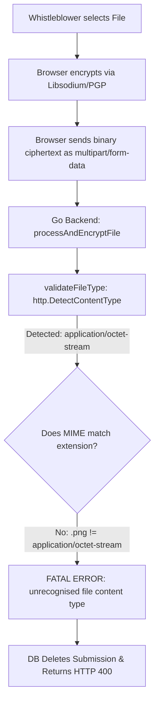
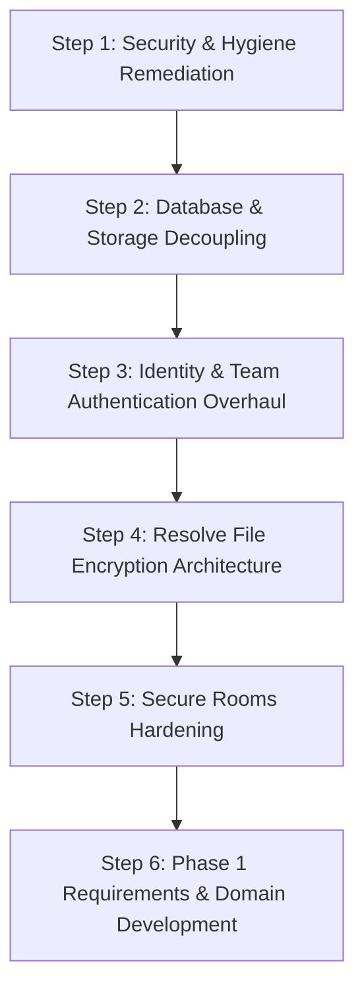

# 🔥 BurnerBox — Complete Repository Audit (Phase 0)

**Document Type:** Technical Architecture, Source Code, Database, Cryptography & Security Audit  
**Audit Baseline Date:** 19 November 2026  
**Auditor Roles:** Senior Software Architect, Go Backend Engineer, SvelteKit Frontend Engineer, Database Architect & Application Security Auditor  
**Primary Reference Standard:** [MASTER_PROJECT_BLUEPRINT.md](file:///E:/burnerbox/docs/MASTER_PROJECT_BLUEPRINT.md) (v1.0 Baseline)  
**Execution Status:** Phase 0 Completed — Ready for Review & Governance Approval  

---

## 1. Executive Summary

BurnerBox is a privacy-first platform designed to encompass three distinct, non-overlapping security domains:
1. **Public Community** (pseudonymous/anonymous discussions, community moderation, threshold identity review).
2. **Secure Rooms** (ephemeral and session-persistent end-to-end encrypted chat rooms, encrypted file sharing, future small-group audio/video).
3. **Secure Organization** (confidential whistleblower submission box, verifiable cryptographic receipts, Merkle log integrity, investigator workflow, role-based access control).

This comprehensive audit of the supplied repository provides an evidence-based evaluation of what is genuinely implemented, what is only partially constructed, what is misaligned with documentation, and what remains completely unimplemented.

### Key Audit Findings

- **Test Suite Health:** All existing automated tests run and pass cleanly:
  - Backend: **39 test functions across 10 packages/suites pass** (`go test ./...` in ~3.1s; statement coverage: `crypto` 29.1%, `handlers` 28.3%, `security` static scan passed).
  - Frontend: **42 test cases across 10 test files pass** (`vitest run` in ~6.6s).
  - Frontend Production Build: **Successfully builds with `@sveltejs/adapter-cloudflare`** (`vite build` in ~11.4s).
- **Public Community Domain is 0% Implemented:** Despite being approved in the Master Blueprint, there are currently **zero** models, database tables, API handlers, frontend routes, or tests for Public Community.
- **Database Driver Contradiction:** While the root `README.md` claims the database is "SQLite (Turso)", the Go backend runtime (`models.ConnectDatabase`) **hardcodes PostgreSQL** via `gorm.Open(postgres.Open(databaseURL))`. SQLite is only used as an in-memory test harness with hand-crafted raw SQL DDL. SQLite is **not** supported in production runtime.
- **Cryptographic Key Exposure in Working Tree:** An active Ed25519 proof-of-submission private key was discovered stored in plaintext JSON at `backend/internal/handlers/data/proof_key.json` and was archived in the source zip.
- **Architectural Collision on File Uploads:** A severe architectural conflict exists between client-side file encryption and server-side file inspection. The frontend encrypts files client-side into binary ciphertext before upload. The backend handler (`files.go`) enforces magic-byte validation (`http.DetectContentType`) and image metadata stripping (`jpeg.Decode`), which fail immediately on ciphertext (`application/octet-stream`), aborting the upload with HTTP 400 and deleting the submission.
- **Incomplete Team Member Authentication:** The database and API allow administrators to invite team members with roles (`admin`, `responder`, `reader`). However, team members have no passwords or login flow. `LoginOrganization` only authenticates against the `organizations` table.
- **Unauthenticated Room Deletion Vulnerability:** The endpoint `DELETE /api/v1/rooms/:code` accepts any room code and permanently destroys the room and all messages/files with zero authentication or password verification.

---

## 2. Repository Structure

The working repository contains the following directory tree:

```
E:\burnerbox
├── .git/                                # Git version control repository
├── .gitignore                           # Root git ignore specification
├── BurnerBox_Project_Source_with_Master_Blueprint.zip # Provided source archive
├── README.md                            # Project overview & Windows quickstart
├── backend/                             # Go Fiber API server
│   ├── .env                             # Local environment secrets (untracked)
│   ├── Dockerfile                       # Multi-stage container build (Alpine runtime)
│   ├── fly.toml                         # Fly.io deployment specification
│   ├── go.mod                           # Go module declaration (go 1.26.5)
│   ├── go.sum                           # Go dependency checksums
│   ├── cmd/
│   │   └── server/
│   │       └── main.go                  # Application entry point, middleware & router
│   ├── internal/
│   │   ├── config/
│   │   │   └── config.go                # Env loading & config parsing
│   │   ├── crypto/                      # Password hashing, JWT, TOTP, Merkle, File crypto
│   │   │   ├── filecrypto.go
│   │   │   ├── jwt.go
│   │   │   ├── merkle.go
│   │   │   ├── merkle_test.go
│   │   │   ├── password.go
│   │   │   └── totp.go
│   │   ├── handlers/                    # Fiber HTTP & WebSocket handlers + unit tests
│   │   │   ├── account.go
│   │   │   ├── account_deletion_test.go
│   │   │   ├── activity.go
│   │   │   ├── admin.go
│   │   │   ├── assignment.go
│   │   │   ├── auth.go
│   │   │   ├── auth_test.go
│   │   │   ├── bulk.go
│   │   │   ├── canary.go
│   │   │   ├── data/
│   │   │   │   └── proof_key.json       # [EXPOSED SECRET] Ed25519 keypair
│   │   │   ├── dms_test.go
│   │   │   ├── export.go
│   │   │   ├── file_security_test.go
│   │   │   ├── files.go
│   │   │   ├── merkle.go
│   │   │   ├── merkle_test.go
│   │   │   ├── notifications.go
│   │   │   ├── proof.go
│   │   │   ├── ratelimit_test.go
│   │   │   ├── rbac_test.go
│   │   │   ├── room_files.go
│   │   │   ├── room_lifecycle_test.go
│   │   │   ├── rooms.go
│   │   │   ├── rooms_ws.go
│   │   │   ├── status_ws.go
│   │   │   ├── submission.go
│   │   │   ├── submission_security_test.go
│   │   │   ├── submission_settings.go
│   │   │   ├── submission_settings_test.go
│   │   │   ├── team.go
│   │   │   ├── test_helper_test.go      # In-memory SQLite test fixtures
│   │   │   ├── thread.go
│   │   │   ├── twofa.go
│   │   │   └── uploads/                 # Test artifacts created during test runs
│   │   ├── middleware/                  # HTTP middleware
│   │   │   ├── auth.go                  # Session-backed JWT verification
│   │   │   ├── ratelimit.go             # In-memory IP/key rate limiters
│   │   │   └── rbac.go                  # Role resolution & hierarchical checking
│   │   ├── models/                      # GORM schema structs & DB connection
│   │   │   ├── database.go
│   │   │   ├── merkle.go
│   │   │   ├── organization.go
│   │   │   ├── room.go
│   │   │   ├── session.go
│   │   │   └── submission.go
│   │   └── security/                    # Automated security compliance tests
│   │       └── no_ip_logging_test.go
│   ├── migrations/                      # Empty directory (no migration files)
│   └── uploads/                         # Local upload directory for file attachments
│       └── submissions/                 # Persistent submission files
├── docs/                                # Project documentation
│   ├── DEPLOYMENT.md
│   ├── MASTER_PROJECT_BLUEPRINT.md      # Primary source of truth
│   ├── PRE_LAUNCH_CHECKLIST.md
│   ├── PRIVACY.md
│   ├── SECURITY.md
│   └── WARRANT_CANARY.md
├── frontend/                            # SvelteKit 5 web application
│   ├── package.json
│   ├── package-lock.json
│   ├── vite.config.js                   # Vite + SvelteKit + Tailwind CSS v4 config
│   ├── static/
│   │   ├── robots.txt
│   │   └── verify-receipt.html          # Standalone offline zero-dependency verifier
│   └── src/
│       ├── app.css                      # Global styling & Tailwind directives
│       ├── app.html                     # HTML root template
│       ├── lib/
│       │   ├── api.js                   # Centralized API/WS URLs & HTTPS enforcement
│       │   ├── auth.js                  # Logout & session clearance
│       │   ├── crypto.js                # Libsodium & OpenPGP encryption wrappers
│       │   ├── i18n.js                  # Multi-language dictionary
│       │   ├── markdown.js              # Safe markdown renderer & sanitization
│       │   ├── pii_scanner.js           # Client-side deterministic regex PII scanner
│       │   ├── theme.js                 # Dark/light theme management
│       │   ├── tts.js                   # Client-side synthetic voice & WAV generation
│       │   └── components/
│       │       ├── CommandPalette.svelte# Quick action search palette (Ctrl+K)
│       │       ├── LanguageSwitcher.svelte # Language selection dropdown
│       │       └── ShortcutsHelp.svelte # Keyboard shortcut dialog
│       ├── routes/                      # SvelteKit route hierarchy
│       │   ├── +layout.svelte           # Root application shell & navigation
│       │   ├── +page.svelte             # Landing page
│       │   ├── check-replies/
│       │   │   └── +page.svelte         # Anonymous submitter reply portal
│       │   ├── dashboard/
│       │   │   ├── +page.svelte         # Org dashboard home
│       │   │   ├── customization/
│       │   │   │   └── +page.svelte     # Portal questionnaire & settings
│       │   │   ├── security/
│       │   │   │   └── +page.svelte     # 2FA, key rotation, dead man's switch
│       │   │   ├── sessions/
│       │   │   │   └── +page.svelte     # Active session revocation
│       │   │   ├── submissions/
│       │   │   │   ├── +page.svelte     # Submissions list, filter & export
│       │   │   │   └── [id]/
│       │   │   │       └── +page.svelte # Submission detail, decryption & thread
│       │   │   └── team/
│       │   │       └── +page.svelte     # Team member invitations & listing
│       │   ├── login/
│       │   │   └── +page.svelte         # Org login & 2FA modal
│       │   ├── room/
│       │   │   ├── +page.svelte         # Redirects to /room/create
│       │   │   ├── [code]/
│       │   │   │   └── +page.svelte     # Real-time encrypted room chat
│       │   │   └── create/
│       │   │       └── +page.svelte     # Ephemeral room creation
│       │   ├── signup/
│       │   │   └── +page.svelte         # Org registration & client keypair generation
│       │   └── submit/
│       │       ├── +page.svelte         # Slug lookup redirect
│       │       └── [slug]/
│       │           └── +page.svelte     # Anonymous submission portal
│       └── tests/                       # Vitest frontend unit & security tests
│           ├── api_security.test.js
│           ├── auth_logout.test.js
│           ├── crypto_flows.test.js
│           ├── customization_and_sessions.test.js
│           ├── i18n.test.js
│           ├── markdown_security.test.js
│           ├── merkle_receipt_verification.test.js
│           ├── pgp_flows.test.js
│           ├── pii_scanner.test.js
│           └── tts_synthetic_voice.test.js
└── scripts/
    ├── backup.sh                        # pg_dump + age encryption backup script
    ├── restore.sh                       # age decryption + pg_restore script
    └── verify-receipt.html              # Standalone verifier copy
```

---

## 3. Technology Stack Inventory

| Component / Layer | Declared / Target Tech | Actual Implemented Tech in Source | Version / Dependency | Verification Status |
|---|---|---|---|---|
| **Frontend Framework** | SvelteKit 5 | SvelteKit 5 (Runes mode) | `svelte`: ^5.56.1, `@sveltejs/kit`: ^2.63.0 | Verified |
| **Frontend Styling** | Tailwind CSS v4 | Tailwind CSS v4 via `@tailwindcss/vite` | `tailwindcss`: ^4.3.3 | Verified |
| **Frontend Build Tool** | Vite | Vite 8 | `vite`: ^8.0.16 | Verified |
| **Frontend Adapter** | Cloudflare Pages | `@sveltejs/adapter-cloudflare` | `^7.2.9` | Verified |
| **Frontend Crypto** | Libsodium & OpenPGP | `libsodium-wrappers` & `openpgp` | `libsodium-wrappers`: ^0.8.4, `openpgp`: ^6.3.1 | Verified |
| **Frontend Testing** | Vitest | Vitest 4 | `vitest`: ^4.1.11 | Verified |
| **Backend Language** | Go | Go (go 1.26.5 detected on host; go.mod targets 1.26.5) | Go 1.26.5 | Verified |
| **Backend HTTP Framework** | Fiber v2 | Fiber v2 | `github.com/gofiber/fiber/v2` v2.52.14 | Verified |
| **Realtime WebSockets** | Fiber WebSocket | `fasthttp/websocket` wrapper | `github.com/gofiber/websocket/v2` v2.2.1 | Verified |
| **Database ORM** | GORM | GORM v1 | `gorm.io/gorm` v1.31.2 | Verified |
| **Production Database** | PostgreSQL | PostgreSQL driver only in runtime | `gorm.io/driver/postgres` v1.6.2 | Verified |
| **Testing Database** | SQLite (in-memory) | Pure Go SQLite (modernc) | `github.com/glebarez/sqlite` v1.11.0 | Verified (Test only) |
| **Password Hashing** | Argon2id | Argon2id (`golang.org/x/crypto/argon2`) | 64MB, 3 iterations, 2 parallelism | Verified |
| **Authentication Tokens**| JWT (HMAC-SHA256) | Golang-JWT v5 | `github.com/golang-jwt/jwt/v5` v5.3.1 | Verified |
| **Two-Factor Auth** | TOTP (RFC 6238) | Pquerna OTP | `github.com/pquerna/otp` v1.5.0 | Verified |
| **Object Storage** | Cloudflare R2 | Local filesystem (`uploads/`) | Filesystem relative path | Discrepancy: R2 not wired |
| **Background Jobs** | Redis / Queue | Goroutines + time.Ticker | In-process memory channels | Discrepancy: No Redis |

---

## 4. Frontend Route and Component Inventory

### Routes

| Route | Svelte File | Purpose / Role | Cryptographic / Sensitive Operations | Backend Endpoints Called |
|---|---|---|---|---|
| `/` | `src/routes/+page.svelte` | Public landing page, navigation | None | None |
| `/login` | `src/routes/login/+page.svelte` | Organization authentication & 2FA challenge | Client key derivation via `deriveKeyFromPassword` (Argon2id); derived key cached in memory | `POST /api/v1/auth/login`, `POST /api/v1/auth/login/2fa` |
| `/signup` | `src/routes/signup/+page.svelte` | Organization account registration | Client-side keypair generation (`crypto_box_keypair` or PGP RSA); client-side key encryption (`encryptPrivateKey`) | `POST /api/v1/auth/signup` |
| `/check-replies` | `src/routes/check-replies/+page.svelte` | Anonymous submitter portal to check status & replies | Local decryption of replies using passphrase-protected reply private key stored in `localStorage` | `GET /api/v1/submit/replies`, `WS /api/v1/submit/:slug/status/:name/ws`, `GET /api/v1/thread`, `POST /api/v1/thread` |
| `/submit` | `src/routes/submit/+page.svelte` | Portal slug lookup & redirect | None | None |
| `/submit/[slug]` | `src/routes/submit/[slug]/+page.svelte` | Anonymous whistleblower submission form | PII regex scanning, synthetic audio synthesis (WAV), payload envelope encryption (`crypto_box` / PGP), file encryption | `GET /api/v1/submit/:slug/public-key`, `POST /api/v1/submit/:slug` |
| `/room` | `src/routes/room/+page.svelte` | Helper redirect | Redirects to `/room/create` | None |
| `/room/create` | `src/routes/room/create/+page.svelte` | Secure room creation | Generates symmetric key (`crypto_secretbox`, 32 bytes); sets `#key=` URL fragment | `POST /api/v1/rooms` |
| `/room/[code]` | `src/routes/room/[code]/+page.svelte` | Real-time ephemeral encrypted chat room | Reads `#key=` from URL fragment; encrypts/decrypts room messages, reactions, and attachments with `crypto_secretbox` | `GET /api/v1/rooms/:code`, `WS /api/v1/rooms/:code/ws`, `POST /api/v1/rooms/:code/files`, `GET /api/v1/rooms/:code/files/:id`, `DELETE /api/v1/rooms/:code` |
| `/dashboard` | `src/routes/dashboard/+page.svelte` | Organization dashboard home | Authenticated session check; overview stats | `GET /api/v1/dashboard`, `GET /api/v1/dashboard/submissions` |
| `/dashboard/submissions` | `src/routes/dashboard/submissions/+page.svelte` | Submissions inbox, search, filter, bulk actions | Bulk status/assign, export to password-encrypted zip (`JSZip`) | `GET /api/v1/dashboard/submissions`, `POST /api/v1/dashboard/submissions/bulk/*`, `POST /api/v1/dashboard/submissions/export` |
| `/dashboard/submissions/[id]` | `src/routes/dashboard/submissions/[id]/+page.svelte` | Submission detail, internal notes, triage | In-browser decryption of tip and files using stored/transient org private key; reply encryption | `GET /api/v1/dashboard/submissions/:id`, `POST /api/v1/dashboard/submissions/:id/reply`, `POST /api/v1/dashboard/submissions/:id/notes`, `GET /api/v1/dashboard/submissions/:id/files/:fileId` |
| `/dashboard/team` | `src/routes/dashboard/team/+page.svelte` | Team member invitation & listing | Admin team role management | `GET /api/v1/dashboard/team`, `POST /api/v1/dashboard/team/invite`, `DELETE /api/v1/dashboard/team/:id` |
| `/dashboard/security` | `src/routes/dashboard/security/+page.svelte` | Security administration | 2FA TOTP setup (QR code), key rotation, dead man's switch, permanent account deletion | `POST /api/v1/dashboard/2fa/*`, `PUT /api/v1/dashboard/public-key`, `GET / PUT /api/v1/dashboard/dead-mans-switch`, `DELETE /api/v1/dashboard/account` |
| `/dashboard/customization` | `src/routes/dashboard/customization/+page.svelte` | Public portal settings & custom form builder | Configure custom questionnaire fields, deadline, retention days, webhooks, notification email | `GET / PUT /api/v1/dashboard/customization`, `GET / PUT /api/v1/dashboard/submission-settings`, `GET / PUT /api/v1/dashboard/retention`, `GET / PUT /api/v1/dashboard/notifications` |
| `/dashboard/sessions` | `src/routes/dashboard/sessions/+page.svelte` | Active session management | Inspect active sessions, revoke remote sessions, revoke all other sessions | `GET /api/v1/dashboard/sessions`, `DELETE /api/v1/dashboard/sessions/:id`, `DELETE /api/v1/dashboard/sessions` |

### Components & Modules

| Component / Module | Path | Description & Security Attributes |
|---|---|---|
| `CommandPalette` | `src/lib/components/CommandPalette.svelte` | Quick navigation modal (Ctrl+K); navigates across dashboard and portals |
| `LanguageSwitcher` | `src/lib/components/LanguageSwitcher.svelte` | Localized UI language switcher (English, Spanish, French, German) |
| `ShortcutsHelp` | `src/lib/components/ShortcutsHelp.svelte` | Keyboard shortcuts reference dialog (Ctrl+/) |
| `api.js` | `src/lib/api.js` | Production HTTPS validation; derives WebSocket endpoints from API URL |
| `auth.js` | `src/lib/auth.js` | Session logout coordinator; clears in-memory keys and localStorage tokens |
| `crypto.js` | `src/lib/crypto.js` | Core cryptographic abstraction: Libsodium (`crypto_box`, `crypto_secretbox`, `crypto_pwhash`) and OpenPGP.js integration |
| `pii_scanner.js` | `src/lib/pii_scanner.js` | Zero-network, client-side regex scanner for Emails, Phones, SSNs, IDs, URLs, and IPs |
| `tts.js` | `src/lib/tts.js` | Client-side text-to-speech preview and synthetic 16-bit PCM WAV audio generator (zero microphone access) |
| `markdown.js` | `src/lib/markdown.js` | XSS-sanitized markdown renderer for internal notes |
| `theme.js` | `src/lib/theme.js` | Theme store for dark/light mode toggling |
| `i18n.js` | `src/lib/i18n.js` | Lightweight reactive translation store |
| `verify-receipt.html` | `static/verify-receipt.html` | Standalone, zero-dependency offline verifier for Ed25519 receipts & Merkle proofs |

---

## 5. Backend Package Inventory

| Package Path | Purpose | Files Included | Unit Test Coverage |
|---|---|---|---|
| `cmd/server` | Application entry point, HTTP routing, background worker launcher, graceful shutdown | `main.go` | 0.0% (integration only) |
| `internal/config` | Environment variable validation, cryptographic key loading | `config.go` | 0.0% |
| `internal/crypto` | Cryptographic primitives: Argon2id password hashing, JWT session signing, TOTP encryption, AES-GCM file crypto, RFC 6962 Merkle tree | `filecrypto.go`, `jwt.go`, `merkle.go`, `merkle_test.go`, `password.go`, `totp.go` | 29.1% |
| `internal/handlers` | HTTP endpoint controllers for authentication, rooms, submissions, admin, files, and Merkle proofs | 21 `.go` source files + 12 `_test.go` files | 28.3% |
| `internal/middleware` | HTTP middleware for JWT/session auth, RBAC role hierarchy, and memory rate limiting | `auth.go`, `ratelimit.go`, `rbac.go` | 0.0% (tested via handlers) |
| `internal/models` | GORM entity models, UUID hooks, and PostgreSQL connection initialization | `database.go`, `merkle.go`, `organization.go`, `room.go`, `session.go`, `submission.go` | 0.0% |
| `internal/security` | Compliance assertions: static AST analysis for zero-IP logging compliance | `no_ip_logging_test.go` | [No statements] (Pass) |

---

## 6. Complete API Endpoint Inventory

| # | HTTP Method | Route URL | Handler Function | Auth Req. | Required Role | Request Payload | Response Schema | Database Entities | Security & Audit Observations |
|---|---|---|---|---|---|---|---|---|---|
| 1 | `GET` | `/api/health` | Anonymous closure | None | Public | None | `{status, message, version}` | None | Discloses backend DB engine ("PostgreSQL") |
| 2 | `GET` | `/api/v1/canary` | `handlers.GetCanary` | None | Public | None | `{last_updated, content}` | None | Reads `docs/WARRANT_CANARY.md` from disk |
| 3 | `GET` | `/api/v1/proof-key` | `handlers.GetProofPublicKey` | None | Public | None | `{public_key, fingerprint}` | None | Exposes server's Ed25519 verification key |
| 4 | `GET` | `/api/v1/stats` | `handlers.GetPublicStats` | None | Public | None | `{total_orgs, total_submissions, active_rooms, note}` | Organization, Submission, Room | Cached in memory for 1 hour to prevent timing leaks |
| 5 | `GET` | `/api/v1/admin/stats` | `handlers.GetAdminStats` | Token | Super-admin (`X-Admin-Token`) | None | `{total_orgs, total_submissions, active_rooms}` | Organization, Submission, Room | Header check uses non-constant-time string comparison |
| 6 | `POST` | `/api/v1/auth/signup` | `handlers.SignupOrganization` | Rate Limit | Public (5/hr/IP) | `{name, email, password, public_key, encryption_scheme}` | `{message, organization}` | Organization | Hashes password with Argon2id; validates scheme |
| 7 | `POST` | `/api/v1/auth/login` | `handlers.LoginOrganization` | Rate Limit | Public (5/15m/IP+email) | `{email, password}` | `{token, organization}` OR `{requires_2fa, pending_token}` | Organization, Session | Creates DB session record; returns session JWT |
| 8 | `POST` | `/api/v1/auth/login/2fa` | `handlers.Login2FA` | Rate Limit | Public (5/15m/IP+token) | `{pending_token, code}` | `{message, token, organization}` | Organization, Session | Verifies TOTP code against decrypted secret; issues session JWT |
| 9 | `POST` | `/api/v1/auth/logout` | `handlers.LogoutOrganization` | JWT | Authenticated | None | `{message}` | Session | Deletes session row from DB immediately |
| 10 | `GET` | `/api/v1/org/:id` | `handlers.GetOrganization` | None | Public | None | `{id, name, submission_slug, public_key, ...}` | Organization | Public profile lookup |
| 11 | `POST` | `/api/v1/rooms` | `handlers.CreateRoom` | None | Public | `{password, expiry_duration}` | `{room_code, join_url, expires_at}` | Room | Room code generated randomly (16 hex chars); hashes optional password |
| 12 | `GET` | `/api/v1/rooms/:code` | `handlers.GetRoomStatus` | None | Public | None | `{exists, expired, destroyed, expires_at}` | Room | Returns status without leaking messages |
| 13 | `DELETE` | `/api/v1/rooms/:code` | `handlers.DestroyRoom` | None | **None (IDOR)** | None | `{message}` | Room, RoomMessage, RoomFile, RoomReaction | **Vulnerability: No authentication or password check; deletes room permanently** |
| 14 | `GET` | `/api/v1/rooms/:code/messages` | `handlers.GetRecentRoomMessages` | None | Public | None | `{messages: [...]}` | Room, RoomMessage | **Vulnerability: Does not enforce room password check** |
| 15 | `POST` | `/api/v1/rooms/:code/files` | `handlers.UploadRoomFile` | None | Public | Multipart: `file`, `sender_tag`, `encryption_meta`, `self_destruct_at` | `{file_id, original_name, mime_type, file_size, ...}` | Room, RoomFile | Stores encrypted binary in PostgreSQL bytea column; no password check |
| 16 | `GET` | `/api/v1/rooms/:code/files/:file_id` | `handlers.DownloadRoomFile` | None | Public | None | Binary octet-stream + custom headers | Room, RoomFile | Sends encrypted bytea from DB; no password check |
| 17 | `WS` | `/api/v1/rooms/:code/ws` | `handlers.JoinRoom` | Optional Pwd | Public / Room Pwd | WebSocket frames (`message`, `typing`, `reaction`, `revival`, `ping`) | Broadcast frames | Room, RoomMessage, RoomReaction | Verifies password if room has hash; enforces max participants (10) |
| 18 | `WS` | `/api/v1/submit/:slug/status/:anonymous_name/ws` | `handlers.JoinStatusStream` | None | Public | None | Pushes `{type: "status", status: "...", time: "..."}` | Organization, Submission | Status listener stream; minimal metadata |
| 19 | `GET` | `/api/v1/submit/:slug/public-key` | `handlers.GetOrganizationPublicKey` | None | Public | None | `{organization_name, public_key, encryption_scheme, custom_fields, ...}` | Organization | Required by submitters to encrypt payloads |
| 20 | `POST` | `/api/v1/submit/:slug` | `handlers.SubmitAnonymousTip` | None | Public | Multipart or JSON: `encrypted_message`, `encryption_meta`, `reply_public_key`, `honeypot_field`, `rendered_at`, `files` | `{message, anonymous_name, submission_id, proof, ...}` | Organization, Submission, SubmissionFile, MerkleBatch, MerkleLeaf | Rejects plaintext if org has public key; detects spam; signs Ed25519 receipt; fails on client-encrypted files |
| 21 | `GET` | `/api/v1/submit/:slug/merkle-roots` | `handlers.GetPortalMerkleRoots` | None | Public | None | `{slug, server_public_key, roots: [...]}` | Organization, MerkleBatch | Public transparency log of sealed Merkle roots |
| 22 | `GET` | `/api/v1/submit/:slug/proof/:id` | `handlers.GetSubmissionInclusionProof` | None | Public | None | `{status, root_hash, root_signature, inclusion_proof: [...]}` | MerkleLeaf, MerkleBatch | Returns RFC 6962 Merkle sibling path |
| 23 | `GET` | `/api/v1/submit/inclusion-proof` | `handlers.GetSubmissionInclusionProof` | None | Public | Query: `submission_id` | Same as above | MerkleLeaf, MerkleBatch | Query parameter alias |
| 24 | `GET` | `/api/v1/portal/:slug/merkle-roots`| `handlers.GetPortalMerkleRoots` | None | Public | None | Same as #21 | Organization, MerkleBatch | Route alias |
| 25 | `GET` | `/api/v1/submit/replies` | `handlers.CheckForReplies` | Rate Limit | Public (30/15m/IP) | Query: `name` (anonymous handle) | `{submission_id, anonymous_name, status, replies: [...]}` | Submission, Reply, Organization | **Vulnerability: Submitter authentication relies solely on guessing anonymous handle** |
| 26 | `GET` | `/api/v1/thread` | `handlers.GetThreadFromSubmitter` | None | Public | Query: `name`, `submission_id` | `{submission_id, timeline: [...], reply_key}` | Submission, Reply, SubmissionMessage | Submitter thread retrieval |
| 27 | `POST` | `/api/v1/thread` | `handlers.AddThreadMessageFromSubmitter` | None | Public | `{anonymous_name, submission_id, encrypted_text, encryption_meta}` | `{message, msg_id}` | Submission, SubmissionMessage | **Vulnerability: No cryptographic signature; anyone with name+id can post** |
| 28 | `GET` | `/api/v1/dashboard/` | Anonymous closure | JWT | Any authenticated role | None | `{message, org_id, email, role}` | None | Dashboard landing check |
| 29 | `GET` | `/api/v1/dashboard/sessions` | `handlers.ListActiveSessions` | JWT | Any role | None | `{sessions: [...]}` | Session | Lists active sessions; no IP/User-Agent stored |
| 30 | `DELETE` | `/api/v1/dashboard/sessions/:id` | `handlers.RevokeSession` | JWT | Any role | None | `{message}` | Session | Revokes specific session ID |
| 31 | `DELETE` | `/api/v1/dashboard/sessions` | `handlers.RevokeAllOtherSessions` | JWT | Any role | None | `{message, revoked_count}` | Session | Revokes all sessions except current |
| 32 | `POST` | `/api/v1/dashboard/2fa/setup` | `handlers.Setup2FA` | JWT | Any role | None | `{secret, qr_code, manual_key}` | Organization | Generates TOTP secret; encrypts at rest |
| 33 | `POST` | `/api/v1/dashboard/2fa/verify` | `handlers.Verify2FA` | JWT | Any role | `{code}` | `{message}` | Organization | Validates TOTP code and activates 2FA |
| 34 | `POST` | `/api/v1/dashboard/2fa/disable` | `handlers.Disable2FA` | JWT | Any role | `{code}` | `{message}` | Organization | Requires valid code to disable 2FA |
| 35 | `GET` | `/api/v1/dashboard/2fa/status` | `handlers.Check2FAStatus` | JWT | Any role | None | `{enabled}` | Organization | Returns boolean 2FA status |
| 36 | `PUT` | `/api/v1/dashboard/public-key` | `handlers.RotatePublicKey` | JWT | `admin` | `{public_key, encryption_scheme}` | `{message, public_key, encryption_scheme}` | Organization | Rotates org encryption key |
| 37 | `GET` | `/api/v1/dashboard/customization`| `handlers.GetCustomizationSettings`| JWT | `admin` | None | `{welcome_message, logo_url, custom_fields}` | Organization | Retrieves portal customization settings |
| 38 | `PUT` | `/api/v1/dashboard/customization`| `handlers.UpdateCustomizationSettings`| JWT | `admin` | `{welcome_message, logo_url, custom_fields}` | `{message, customization}` | Organization | Updates custom questionnaire fields |
| 39 | `GET` | `/api/v1/dashboard/submission-settings` | `handlers.GetSubmissionSettings` | JWT | `admin` | None | `{submission_slug, deadline}` | Organization | Retrieves submission portal settings |
| 40 | `PUT` | `/api/v1/dashboard/submission-settings` | `handlers.UpdateSubmissionSettings` | JWT | `admin` | `{deadline}` | `{message, deadline}` | Organization | Sets portal closure deadline |
| 41 | `GET` | `/api/v1/dashboard/dead-mans-switch` | `handlers.GetDeadMansSwitch` | JWT | `admin` | None | `{enabled, trigger_days, action_type, last_login_at, ...}` | DeadMansSwitch | Retrieves dead man's switch status |
| 42 | `PUT` | `/api/v1/dashboard/dead-mans-switch` | `handlers.UpdateDeadMansSwitch` | JWT | `admin` | `{enabled, trigger_days, action_type, encrypted_config, password, totp_code}` | `{message, ...}` | DeadMansSwitch, Organization | Re-authenticates password & 2FA before update |
| 43 | `GET` | `/api/v1/dashboard/retention` | `handlers.GetRetentionSettings` | JWT | `admin` | None | `{retention_days}` | Organization | Retrieves auto-deletion retention policy |
| 44 | `PUT` | `/api/v1/dashboard/retention` | `handlers.UpdateRetentionSettings` | JWT | `admin` | `{retention_days}` | `{message, retention_days}` | Organization | Configures 1-3650 days auto-purge lifecycle |
| 45 | `GET` | `/api/v1/dashboard/notifications`| `handlers.GetNotificationSettings`| JWT | `admin` | None | `{webhook_url, notification_email}` | Organization | Retrieves outbound alert configs |
| 46 | `PUT` | `/api/v1/dashboard/notifications`| `handlers.UpdateNotificationSettings`| JWT | `admin` | `{webhook_url, notification_email}` | `{message, ...}` | Organization | Validates webhook URL with private IP check |
| 47 | `POST` | `/api/v1/dashboard/team/invite` | `handlers.InviteTeamMember` | JWT | `admin` | `{email, role}` | `{message, member}` | TeamMember | Invites member (no password/login created) |
| 48 | `GET` | `/api/v1/dashboard/team` | `handlers.ListTeamMembers` | JWT | `admin` | None | `{members: [...], count}` | TeamMember | Lists organization team members |
| 49 | `DELETE`| `/api/v1/dashboard/team/:id` | `handlers.RemoveTeamMember` | JWT | `admin` | None | `{message}` | TeamMember | Removes team member from org |
| 50 | `DELETE`| `/api/v1/dashboard/account` | `handlers.DeleteAccount` | JWT | `admin` | `{password, totp_code}` | `{message}` | All organization entities | Hard-deletes org and all associated submissions & files |
| 51 | `GET` | `/api/v1/dashboard/submissions` | `handlers.GetOrganizationSubmissions` | JWT | Any role (`reader`+) | Query filters: `status`, `priority`, `assigned_to_me`, `sort`, `order` | `{submissions: [...], total, unread_count}` | Submission | Tenant-isolated query |
| 52 | `GET` | `/api/v1/dashboard/submissions/:id` | `handlers.GetSubmission` | JWT | Any role (`reader`+) | None | `{submission, files, replies}` | Submission, SubmissionFile, Reply | Scoped by `id` AND `organization_id` |
| 53 | `PUT` | `/api/v1/dashboard/submissions/:id` | `handlers.UpdateSubmissionStatus` | JWT | `responder`+ | `{status, priority, internal_notes}` | `{message, submission}` | Submission, Activity | Logs activity event; pushes WebSocket status update |
| 54 | `PUT` | `/api/v1/dashboard/submissions/:id/assign` | `handlers.AssignSubmission` | JWT | `responder`+ | `{assigned_to}` | `{message, assigned_to}` | Submission, TeamMember, Activity | Assigns team member; verifies member belongs to org |
| 55 | `POST` | `/api/v1/dashboard/submissions/:id/reply` | `handlers.ReplyToSubmission` | JWT | `responder`+ | `{encrypted_message, encryption_meta, message_text}` | `{message, reply}` | Submission, Reply, Activity | Requires encryption if submitter provided reply key |
| 56 | `POST` | `/api/v1/dashboard/submissions/:id/files` | `handlers.UploadSubmissionFile` | JWT | `responder`+ | Multipart: `file`, `client_encryption_meta` | `{file_id, file_name, file_size, mime_type}` | Submission, SubmissionFile | Re-encrypts file with server key on disk |
| 57 | `GET` | `/api/v1/dashboard/submissions/:id/files` | `handlers.GetSubmissionFiles` | JWT | Any role (`reader`+) | None | `{files: [...], count}` | Submission, SubmissionFile | Lists files attached to submission |
| 58 | `GET` | `/api/v1/dashboard/submissions/:id/files/:fileId` | `handlers.DownloadSubmissionFile` | JWT | Any role (`reader`+) | None | Binary payload + client meta headers | Submission, SubmissionFile | Decrypts server-side layer; serves binary |
| 59 | `POST` | `/api/v1/dashboard/submissions/:id/notes` | `handlers.AddInternalNote` | JWT | `responder`+ | `{content, parent_note_id}` | `{message, note}` | Submission, InternalNote, Activity | Adds threaded internal note |
| 60 | `GET` | `/api/v1/dashboard/submissions/:id/notes` | `handlers.GetInternalNotes` | JWT | Any role (`reader`+) | None | `{notes: [...]}` | Submission, InternalNote | Retrieves threaded notes |
| 61 | `GET` | `/api/v1/dashboard/submissions/:id/activity` | `handlers.GetSubmissionActivity` | JWT | Any role (`reader`+) | None | `{activities: [...]}` | Activity | Audit log of mutations on submission |
| 62 | `GET` | `/api/v1/dashboard/submissions/:id/messages` | `handlers.GetThreadMessages` | JWT | Any role (`reader`+) | None | `{submission_id, timeline: [...]}` | Submission, Reply, SubmissionMessage | Unified chronological thread timeline |
| 63 | `POST` | `/api/v1/dashboard/submissions/:id/messages` | `handlers.AddThreadMessageFromOrg` | JWT | `responder`+ | `{encrypted_text, encryption_meta}` | `{message, msg_id}` | Submission, SubmissionMessage | Adds org-authored follow-up message |
| 64 | `POST` | `/api/v1/dashboard/submissions/bulk/status` | `handlers.BulkUpdateStatus` | JWT | `responder`+ | `{ids: [...], status}` | `{message, count}` | Submission, Activity | Bulk status mutation |
| 65 | `POST` | `/api/v1/dashboard/submissions/bulk/assign` | `handlers.BulkAssign` | JWT | `responder`+ | `{ids: [...], assigned_to}` | `{message, count}` | Submission, TeamMember, Activity | Bulk assignment mutation |
| 66 | `POST` | `/api/v1/dashboard/submissions/export` | `handlers.ExportSubmissions` | JWT | `responder`+ | `{ids: [...]}` | `{count, data_json}` (base64 JSON) | All submission related models | Packages raw ciphertext for client-side zip creation |

---

## 7. Database Schema and Configuration Inventory

### GORM AutoMigrate Entities

The runtime application calls `DB.AutoMigrate` inside `internal/models/database.go` across 16 models:

1. `Organization`: Core tenant entity. Stores name, unique email, Argon2id password hash, public key, encryption scheme (`libsodium` | `pgp`), submission slug, customization JSON, AES-encrypted TOTP secret, retention days, deadline, and notification configs.
2. `Session`: Active authenticated sessions. Stores `id` (UUID), `organization_id`, SHA-256 hash of JWT (`token_hash`), `created_at`, `last_seen_at`, and `expires_at`. Excludes IP and User-Agent.
3. `TeamMember`: Sub-account invitations. Stores `organization_id`, `email`, `role` (`admin`, `responder`, `reader`), `invited_at`, and `accepted_at`.
4. `Submission`: Whistleblower submissions. Stores `organization_id`, `anonymous_name`, `encrypted_message`, `encryption_meta`, legacy `message_text`, `reply_public_key`, status, priority, `assigned_to` (UUID foreign key to `TeamMember`), and `internal_notes`.
5. `SubmissionFile`: Attachments to submissions. Stores `submission_id`, `file_name`, `file_size`, `storage_key` (local path), `mime_type`, `encryption_meta` (client E2EE meta), and `file_encryption_key` (server AES-GCM nonce).
6. `Reply`: Organization replies to submitters. Stores `submission_id`, `encrypted_message`, `encryption_meta`, legacy `message_text`.
7. `SubmissionMessage`: Multi-turn conversational thread entries. Stores `submission_id`, `organization_id`, `anonymous_name`, `sender_type` (`org` | `submitter`), `encrypted_text`, `encryption_meta`.
8. `InternalNote`: Threaded investigator staff notes. Stores `submission_id`, `organization_id`, `author_email`, `author_role`, `content`, `parent_note_id` (nullable UUID for threading), `depth`.
9. `Activity`: Audit trail of mutations. Stores `submission_id`, `organization_id`, `actor_email`, `actor_role`, `action_type`, `detail`, `created_at`.
10. `Room`: Ephemeral chat rooms. Stores `room_code` (16 hex chars), `password_hash` (optional), `max_participants`, `expires_at`, `destroyed_at`.
11. `RoomMessage`: Ephemeral room messages. Stores `room_code`, `sender_tag`, `encrypted_message`, `encryption_meta`, `self_destruct_at`.
12. `RoomFile`: Encrypted room file attachments. Stores `room_code`, `sender_tag`, `original_name`, `mime_type`, `file_size`, `encrypted_data` (`bytea`), `encryption_meta`, `self_destruct_at`.
13. `RoomReaction`: Encrypted emoji reactions. Stores `room_code`, `message_id`, `sender_tag`, `encrypted_emoji`, `encryption_meta`.
14. `DeadMansSwitch`: Per-organization canary switch. Stores `organization_id`, `enabled`, `trigger_days`, `action_type`, `encrypted_config`, `last_login_at`, `triggered_at`.
15. `MerkleBatch`: Append-only batch container. Stores `organization_id`, `batch_number`, `status` (`open` | `sealed`), `root_hash`, `signature`, `key_fingerprint`, `leaf_count`, `sealed_at`.
16. `MerkleLeaf`: Submission leaf in Merkle tree. Stores `batch_id`, `organization_id`, `submission_id`, `leaf_index`, `leaf_hash`.

### Database Driver & Engine Reality Check

- **Runtime Database Support:** **PostgreSQL is the only supported database engine.** `models.ConnectDatabase` hardcodes `gorm.Open(postgres.Open(databaseURL), ...)` and crashes if provided an SQLite connection string.
- **SQLite Status:** The SQLite driver `github.com/glebarez/sqlite` is exclusively imported in `test_helper_test.go` to back in-memory unit tests. It is not reachable by the production server.
- **Turso Status:** Root `README.md` claims "Database: SQLite (Turso)". There is **zero** code, driver, or configuration for Turso anywhere in the repository.
- **Migrations:** `backend/migrations/` is completely empty. The system relies entirely on GORM `AutoMigrate()`. There are no versioned SQL migration scripts, rollback mechanisms, or migration locking.

---

## 8. Authentication and Authorization Assessment

### Authentication Strengths
1. **Password Hashing:** Argon2id with 64 MB memory, 3 iterations, 2 threads, 16-byte random salt, and 32-byte key (`crypto/password.go`). Verification uses `subtle.ConstantTimeCompare`.
2. **Stateful Session Revocation:** JWTs contain a `session_id` claim. The `Protected()` middleware verifies the session against the `sessions` table, checks expiry, and compares the SHA-256 hash of the bearer token against `session.TokenHash`. Revoking a session in the database immediately invalidates the bearer token across all subsequent requests.
3. **MFA / TOTP:** RFC 6238 TOTP using SHA-1, 30s steps, 6 digits. TOTP secrets are encrypted at rest with AES-256-GCM using `TOTP_ENCRYPTION_KEY`. Login with 2FA enabled returns a scoped, 5-minute `pending_token` that cannot access dashboard endpoints.
4. **Permanent Account Deletion:** `DELETE /api/v1/dashboard/account` requires re-authenticating the admin's password and verifying a live 6-digit TOTP code if 2FA is active. Deletion executes in an atomic database transaction cascading across all 11 organization-linked tables and physically deletes submission files from disk.

### Authorization Vulnerabilities & Architectural Gaps
1. **Unauthenticated Room Deletion (`DELETE /api/v1/rooms/:code`):** Completely unauthenticated. Anyone who knows or guesses a room code can delete the room.
2. **Missing Room Password Enforcement on REST:** `GET /api/v1/rooms/:code/messages`, `POST /api/v1/rooms/:code/files`, and `GET /api/v1/rooms/:code/files/:file_id` do not require the room password, completely bypassing password protection for message history and file exchange.
3. **Team Member Authentication Deficit:** While RBAC middleware enforces permissions (`admin` > `responder` > `reader`), team members cannot log in. `LoginOrganization` only checks the `organizations` table.
4. **Submitter Reply Keyless Access:** `CheckForReplies` and `GetThreadFromSubmitter` rely solely on the submitter's `anonymous_name` without requiring a cryptographic signature or token.

---

## 9. Cryptography Assessment

| Operation | Algorithm / Library | Key Size / Parameters | Nonce / IV Handling | Key Storage / Lifecycle | Status in Code |
|---|---|---|---|---|---|
| **Org Password Hash** | Argon2id (`golang.org/x/crypto/argon2`) | $m=64\text{MB}, t=3, p=2$, Key: 32B | 16-byte cryptographically random salt (`crypto/rand`) | Stored as standard encoded string in `organizations.password_hash` | Implemented & Verified |
| **Session JWT Signing** | HMAC-SHA256 (`golang-jwt/jwt/v5`) | 256-bit secret | N/A | Server secret via `JWT_SECRET` env var | Implemented & Verified |
| **TOTP Secret Encryption** | AES-256-GCM (`crypto/aes`, `crypto/cipher`) | 256-bit key | 12-byte random nonce prefixed to ciphertext (`crypto/rand`) | Server master key via `TOTP_ENCRYPTION_KEY` env var | Implemented & Verified |
| **Server File Encryption** | AES-256-GCM + HMAC-SHA256 KDF | 256-bit derived key from master key + 32-byte file nonce | 12-byte random GCM nonce prefixed to file ciphertext | Master key via `FILE_ENCRYPTION_KEY` env var; per-file nonce stored in DB | Implemented & Verified |
| **Proof-of-Submission** | Ed25519 digital signature (`crypto/ed25519`) | 256-bit Ed25519 keypair | N/A (deterministic Ed25519 signature) | Persisted in plaintext JSON at `backend/internal/handlers/data/proof_key.json` | **Vulnerability: Plaintext key on disk** |
| **Merkle Tree Log** | RFC 6962 Domain-Separated SHA-256 | 256-bit SHA-256 hashes | Prefix `0x00` for leaves, `0x01` for internal nodes | Roots signed with Ed25519 server key; leaves stored in DB | Implemented & Verified |
| **Client Tip Encryption (Libsodium)** | NaCl `crypto_box` + `crypto_secretbox` (`libsodium-wrappers`) | Curve25519 keypair + 256-bit XSalsa20 symmetric key | 24-byte random nonce for secretbox; 24-byte random nonce for box | Org private key stored in `localStorage` encrypted via Argon2id + secretbox; server sees ciphertext only | Implemented & Verified |
| **Client Tip Encryption (OpenPGP)** | OpenPGP.js RSA-2048 / Armor (`openpgp`) | 2048-bit RSA keypair | Managed by OpenPGP CFB mode | Org private key stored transiently in memory only (never written to disk/localStorage) | Implemented & Verified |
| **Room Message Encryption** | NaCl `crypto_secretbox` (`libsodium-wrappers`) | 256-bit symmetric key (XSalsa20) | 24-byte random nonce per message (`randombytes_buf`) | Symmetric key embedded in URL fragment `#key=...`; never transmitted to server | Implemented & Verified |
| **Room File Encryption** | NaCl `crypto_secretbox` (`libsodium-wrappers`) | 256-bit symmetric key (XSalsa20) | 24-byte random nonce per file | Shared room symmetric key | Implemented & Verified |
| **Group E2EE Protocol (MLS)** | Messaging Layer Security | None | None | None | **Missing (Blueprint proposed)** |
| **Threshold Identity Review** | 3-of-5 Distributed Key Decryption | None | None | None | **Missing (Blueprint proposed)** |

---

## 10. Secure Rooms Assessment

### What Works
- **Room Creation:** `POST /api/v1/rooms` generates an unguessable 16-hex room code and sets expiration (default 24h, max 7 days).
- **Client-Side Key Distribution:** SvelteKit frontend generates a 32-byte symmetric key locally and places it in the URL fragment (`/room/{code}#key={base64key}`).
- **Ciphertext Relay & DB Persistence:** `JoinRoom` WebSocket relays only `encrypted_message` and `encryption_meta`. The server cannot decrypt messages.
- **Self-Destruct Timers:** Messages with TTL (10s to 10m) calculate `self_destruct_at`. Background worker `CleanupExpiredRooms()` deletes expired messages every 60s.
- **Encrypted Room Files:** Files up to 10MB are encrypted in the browser using the room's symmetric key and stored as `bytea` in PostgreSQL.
- **Revival Proposals:** Majority voting mechanism exists over WebSockets to extend an expiring room's lifetime.

### What is Missing or Weak
- **No Forward Secrecy / Post-Compromise Security:** The room uses a single static symmetric key. There is no MLS or double ratchet; if the link is ever leaked, all past and future room messages are compromised.
- **No Participant Authentication:** Participants receive random pseudonyms (`GenerateSenderTag()`) but have no verifiable public keys or identity assertions.
- **Unauthenticated Deletion:** `DELETE /api/v1/rooms/:code` allows any unauthenticated caller to destroy the room.
- **Bypassed Room Passwords:** REST endpoints for room messages and file downloads completely ignore room passwords.
- **Audio / Video:** Small-group calls (WebRTC 5-person mesh or SFU) are completely unimplemented.

---

## 11. Secure Organization Assessment

### What Works
- **Organization Onboarding:** Self-serve registration with client-side key generation (Libsodium or OpenPGP).
- **Encrypted Submissions:** Rejects plaintext tip submissions when public key is configured.
- **Spam Mitigation:** Dynamic honeypot fields (`hp_<random>`) and client fill-time verification (< 2000ms discard). Spam submissions receive generic HTTP 201 without Ed25519 proof receipts.
- **Append-Only Merkle Log:** Submissions are batched into Merkle trees (RFC 6962), signed with the server's Ed25519 key, and published at `/portal/:slug/merkle-roots`. Inclusion proofs can be verified offline via `static/verify-receipt.html`.
- **Triage & Internal Collaboration:** Submission status updates, priority setting, internal notes with XSS-safe markdown rendering, and mutation activity audit logs.
- **Multi-Turn Threads:** End-to-end encrypted follow-up communication between submitter and organization using submitter's reply keypair.

### What is Missing or Requires Architectural Development
- **Separation of Submission Modes (Mode A vs Mode B):** Blueprint §12.2 specifies two clear modes: Controlled Submission (app receives and manages data under strict controls) vs Recipient-Encrypted Submission (client encrypts strictly for investigator). Current code implements a single hybrid flow with no mode toggle.
- **Conflict of Interest Handling:** Blueprint §12.5 specifies investigator conflict-of-interest declarations and automatic alternate routing. Not implemented.
- **Threshold Identity Review (3-of-5 Custodian Decryption):** Blueprint §10.5 & §12.6 specify an auditable multi-custodian threshold workflow. Completely unimplemented.
- **Granular RBAC Execution:** Compliance officer, investigator, and auditor roles with case-specific scoping are not implemented. Only static `admin`, `responder`, and `reader` roles exist.

---

## 12. File Storage and Data Lifecycle Assessment

### Uploads & File Processing Conflict



This is a critical architectural failure:
- In `frontend/src/routes/submit/[slug]/+page.svelte` (lines 288-300), the browser encrypts selected files with the organization's public key and appends them as binary blobs with their original filenames.
- In `backend/internal/handlers/files.go` (lines 69-99), `validateFileType` sniffs magic bytes on the first 512 bytes. Because the file is encrypted, it sniffs `application/octet-stream`, which does not match `.jpg`, `.png`, or `.pdf`.
- Furthermore, `stripImageMetadata` attempts `jpeg.Decode(reader)`, which crashes on ciphertext.
- As a result, **file attachments are completely broken in the end-to-end encrypted submission flow**.

### Retention & Expiration Lifecycle
- **Room Messages:** Cleaned up by `CleanupExpiredRooms()` running every 60s. Hard-deletes messages where `self_destruct_at < NOW()` and rooms where `expires_at < NOW()`.
- **Submission Retention:** Cleaned up by `CleanupRetainedSubmissions()` running hourly. Deletes submissions older than `org.RetentionDays`, hard-deleting associated database records and deleting disk files via `os.Remove`.
- **Account Deletion:** Atomic hard-deletion of organization and all dependent rows in 11 tables plus deletion of upload directories.

---

## 13. Existing Test Results

### Backend Test Results

Command executed:
```powershell
cd backend
go test -v ./...
```
Environment: Windows 11 amd64, Go version go1.26.5.

**Result Summary:** 39 test functions across 7 packages; **39 PASSED, 0 FAILED, 0 SKIPPED**.

| Package | Test Function | Result | Duration |
|---|---|---|---|
| `internal/crypto` | `TestMerkleTree_SingleLeaf` | PASS | 0.00s |
| `internal/crypto` | `TestMerkleTree_MultipleLeaves` (10 subtests) | PASS | 0.00s |
| `internal/crypto` | `TestMerkleTree_OutOfBounds` | PASS | 0.00s |
| `internal/handlers` | `TestDeleteAccount_RejectsNonAdminRole` | PASS | 0.14s |
| `internal/handlers` | `TestDeleteAccount_RejectsWrongPassword` | PASS | 0.23s |
| `internal/handlers` | `TestDeleteAccount_RejectsMissingOrInvalidTOTP_When2FAEnabled` | PASS | 0.30s |
| `internal/handlers` | `TestDeleteAccount_HardDeletesOrgAndAllAssociatedData` | PASS | 0.22s |
| `internal/handlers` | `TestSignup_CreatesOrgWithHashedPasswordAndPublicKey` | PASS | 0.20s |
| `internal/handlers` | `TestLogin_IssuesSessionToken_WhenTOTPDisabled` | PASS | 0.20s |
| `internal/handlers` | `TestLogin_RequiresTOTP_WhenEnabled` | PASS | 0.20s |
| `internal/handlers` | `TestLogin2FA_IssuesSessionToken_WithValidTOTPCode` | PASS | 0.01s |
| `internal/handlers` | `TestLogin2FA_RejectsInvalidTOTPCode_WithUnauthorized` | PASS | 0.01s |
| `internal/handlers` | `TestLogin2FA_RejectsInvalidPendingToken_WithUnauthorized` | PASS | 0.00s |
| `internal/handlers` | `TestSignup_SupportsPGPEncryptionScheme` | PASS | 0.20s |
| `internal/handlers` | `TestRotatePublicKey_SwitchesToPGPScheme` | PASS | 0.21s |
| `internal/handlers` | `TestLogin_CreatesDBSessionAndEmbedsSessionID` | PASS | 0.21s |
| `internal/handlers` | `TestProtected_RejectsRevokedSession_ImmediatelyWith401` | PASS | 0.21s |
| `internal/handlers` | `TestSession_RevokeAllOtherSessions_PreservesCurrentSession` | PASS | 0.21s |
| `internal/handlers` | `TestAuthLogout_DeletesSessionRowAndRemovesFromActiveSessions` | PASS | 0.20s |
| `internal/handlers` | `TestDMSPublishWarrantCanary` | PASS | 0.01s |
| `internal/handlers` | `TestDMSReAuthPasswordVerification` | PASS | 0.40s |
| `internal/handlers` | `TestDMSReAuthTOTPVerification` | PASS | 0.42s |
| `internal/handlers` | `TestFileUpload_RejectsMismatchedExtensionContent_ExeDisguisedAsJpg` | PASS | 0.00s |
| `internal/handlers` | `TestFileUpload_RejectsMismatchedExtensionContent_HtmlDisguisedAsPdf` | PASS | 0.00s |
| `internal/handlers` | `TestFileUpload_AcceptsValidMagicBytes_Jpeg` | PASS | 0.00s |
| `internal/handlers` | `TestFileUpload_AcceptsValidMagicBytes_Png` | PASS | 0.00s |
| `internal/handlers` | `TestFileUpload_AcceptsValidMagicBytes_Pdf` | PASS | 0.00s |
| `internal/handlers` | `TestFileUpload_AcceptsValidMagicBytes_Wav` | PASS | 0.00s |
| `internal/handlers` | `TestFileUpload_RejectsDisguisedFileInMultipartUpload` | PASS | 0.01s |
| `internal/handlers` | `TestAddSubmissionToMerkleBatch_CreatesOpenBatchAndAppendsLeaf` | PASS | 0.00s |
| `internal/handlers` | `TestSealBatch_ComputesValidRootAndSignsWithEd25519` | PASS | 0.01s |
| `internal/handlers` | `TestGetSubmissionInclusionProof_ReturnsValidProofVerifiableAgainstSealedRoot` | PASS | 0.00s |
| `internal/handlers` | `TestGetPortalMerkleRoots_ReturnsSealedBatchesPublicly` | PASS | 0.00s |
| `internal/handlers` | `TestRateLimitLogin_BlocksAfterMaxAttemptsPerIPEmail` | PASS | 0.00s |
| `internal/handlers` | `TestRateLimit2FA_BlocksAfterMaxAttemptsPerIPToken` | PASS | 0.00s |
| `internal/handlers` | `TestRateLimitReplies_BlocksAfter30Attempts` | PASS | 0.00s |
| `internal/handlers` | `TestRateLimitSignup_BlocksAfter5AttemptsPerHour` | PASS | 0.00s |
| `internal/handlers` | `TestRBAC_ReaderCanViewSubmissions_CannotReply` | PASS | 0.00s |
| `internal/handlers` | `TestRBAC_ResponderCanReplyAndAssign_CannotInviteTeam` | PASS | 0.00s |
| `internal/handlers` | `TestRBAC_AdminCanInviteAndRemoveTeam` | PASS | 0.01s |
| `internal/handlers` | `TestRoomLifecycle_ExpiredRooms_HardDeleted` | PASS | 0.01s |
| `internal/handlers` | `TestRoomLifecycle_SelfDestructMessages_HardDeleted` | PASS | 0.01s |
| `internal/handlers` | `TestRoomLifecycle_DestroyRoom_HardDeletesAllCascades` | PASS | 0.01s |
| `internal/handlers` | `TestSubmitAnonymousTip_RejectsPlaintextOnly_WithBadRequest` | PASS | 0.00s |
| `internal/handlers` | `TestSubmitAnonymousTip_AcceptsEncryptedPayload_WithCreated` | PASS | 0.00s |
| `internal/handlers` | `TestReplyToSubmission_RejectsPlaintextOnly_WithBadRequest` | PASS | 0.00s |
| `internal/handlers` | `TestReplyToSubmission_AcceptsEncryptedPayload_WithCreated` | PASS | 0.00s |
| `internal/handlers` | `TestSubmitAnonymousTip_HoneypotField_SilentlyDiscardsSubmission` | PASS | 0.00s |
| `internal/handlers` | `TestSubmitAnonymousTip_FastFillTime_SilentlyDiscardsSubmission` | PASS | 0.00s |
| `internal/handlers` | `TestSubmitAnonymousTip_LegitimateHumanSubmission_PersistsToDatabase` | PASS | 0.00s |
| `internal/handlers` | `TestSubmitAnonymousTip_SpamVsGenuine_ProofComparison` | PASS | 0.00s |
| `internal/handlers` | `TestGetOrganizationPublicKey_ReturnsPGPScheme` | PASS | 0.00s |
| `internal/handlers` | `TestSubmitAnonymousTip_AcceptsPGPEncryptedTip` | PASS | 0.00s |
| `internal/handlers` | `TestCustomizationSettings_GetAndUpdate` | PASS | 0.01s |
| `internal/handlers` | `TestCustomizationSettings_ValidatesLogoURLAndFieldTypes` | PASS | 0.00s |
| `internal/security` | `TestNoIPLogging` | PASS | 0.01s |
| `internal/security` | `TestNoIPLoggingFormatStrings` | PASS | 0.01s |
| `internal/security` | `TestNoIPLoggingInLogCalls` | PASS | 0.01s |
| `internal/security` | `TestNoIPLoggingInFiberLoggerFormat` | PASS | 0.01s |
| `internal/security` | `TestNoIPLoggingIndirectAssignment` | PASS | 0.03s |
| `internal/security` | `TestIPFormatStringRegexPatterns` | PASS | 0.00s |

### Frontend Test Results

Command executed:
```powershell
cd frontend
npm ci
npm test
```
Environment: Node v22.14.0, npm 10.9.2, Vitest v4.1.11.

**Result Summary:** 10 test files; **42 PASSED, 0 FAILED**.

| Test File | Tests Passed | Duration |
|---|---|---|
| `src/tests/merkle_receipt_verification.test.js` | 3 passed | 29ms |
| `src/tests/pii_scanner.test.js` | 9 passed | 20ms |
| `src/tests/api_security.test.js` | 2 passed | 8ms |
| `src/tests/markdown_security.test.js` | 3 passed | 48ms |
| `src/tests/crypto_flows.test.js` | 6 passed | 24ms |
| `src/tests/auth_logout.test.js` | 2 passed | 12ms |
| `src/tests/i18n.test.js` | 2 passed | 8ms |
| `src/tests/customization_and_sessions.test.js` | 3 passed | 888ms |
| `src/tests/pgp_flows.test.js` | 8 passed | 2662ms |
| `src/tests/tts_synthetic_voice.test.js` | 4 passed | 5916ms |

### Static Analysis, Build & Audit Results

- **Go Static Analysis (`go vet ./...`):** Clean exit with code 0 (zero warnings).
- **Go Formatting (`gofmt -l .`):** 25 Go files flagged as non-canonically formatted.
- **Frontend Production Build (`npm run build`):** Clean exit with code 0. Adapter `@sveltejs/adapter-cloudflare` generated valid Cloudflare output.
- **NPM Vulnerability Audit (`npm audit`):** 12 vulnerabilities found (1 low, 3 moderate, 8 high) across dev dependencies (`@sveltejs/kit`, `sharp`, `undici`, `vite`, `devalue`).

---

## 14. Security Findings

### Summary Count
- **Critical:** 1
- **High:** 2
- **Medium:** 3
- **Low:** 3
- **Informational:** 3

---

### Finding BB-SEC-001: Plaintext Ed25519 Proof Private Key Stored in Working Tree & Archive
- **Severity:** Critical
- **Affected File:** `backend/internal/handlers/data/proof_key.json`
- **Description:** An active, base64-encoded Ed25519 private key was found stored in a plaintext JSON file inside the repository tree and was included in the source archive zip.
- **Potential Impact:** An attacker obtaining this key can forge non-repudiable server proof signatures and sign fraudulent Merkle tree roots, completely subverting receipt integrity.
- **Evidence:** `internal/handlers/data/proof_key.json` exists with `private_key` field populated.
- **Remediation:** Remove `proof_key.json` from git history and archives. In production, load the Ed25519 signing key exclusively from a secure environment variable or KMS (`PROOF_SIGNING_PRIVATE_KEY`), never persisting it to disk. Add `data/proof_key.json` to `.gitignore`.
- **Verification Method:** Verify git status and `.gitignore`; assert tests generate keys in memory only.

---

### Finding BB-SEC-002: Unauthenticated Room Deletion (IDOR / Denial of Service)
- **Severity:** High
- **Affected File:** `backend/internal/handlers/rooms.go` (`DestroyRoom`)
- **Description:** The `DELETE /api/v1/rooms/:code` endpoint accepts any room code and immediately hard-deletes the room and all its associated messages, reactions, and files. It requires no session token, no creator secret, and no password verification.
- **Potential Impact:** Anyone who knows or scans a room code can prematurely terminate private chat rooms and destroy active communications for all participants.
- **Evidence:**
  ```go
  // rooms.go:130
  func DestroyRoom(c *fiber.Ctx) error {
      code := c.Params("code")
      // Executes transaction deleting RoomFile, RoomReaction, RoomMessage, and Room
  }
  ```
- **Remediation:** Require a room creator authorization token (e.g. an ephemeral bearer capability returned only to the creator upon creation) or require the room password if one was set.
- **Verification Method:** Send a DELETE request without creator authorization and assert HTTP 401/403.

---

### Finding BB-SEC-003: Architectural Collision on Client-Encrypted File Uploads
- **Severity:** High
- **Affected Files:** `frontend/src/routes/submit/[slug]/+page.svelte`, `backend/internal/handlers/files.go` (`validateFileType`, `stripImageMetadata`), `backend/internal/handlers/submission.go` (line 319)
- **Description:** The frontend encrypts files with Libsodium or PGP before upload, producing raw ciphertext. The backend handler enforces magic-byte sniffing (`http.DetectContentType`) and image decoding (`jpeg.Decode`), which fail immediately on ciphertext (`application/octet-stream`), returning HTTP 400 and deleting the submission.
- **Potential Impact:** The core whistleblower feature of encrypted file attachments is completely broken in production end-to-end flows.
- **Evidence:** `files.go` line 74 tests magic bytes against `mimeToExt`, which contains no entry for `application/octet-stream`. `frontend/src/routes/submit/[slug]/+page.svelte` lines 288-296 sends encrypted blobs with original file extensions.
- **Remediation:** Align implementation with Blueprint §11.4 & §12.2: The server cannot perform plaintext magic-byte validation or EXIF stripping on client-encrypted files. Files should either be sanitized client-side before encryption, or stored as opaque ciphertext blobs.
- **Verification Method:** Create an integration test uploading a client-encrypted file to `POST /api/v1/submit/:slug` and verify successful persistence and retrieval.

---

### Finding BB-SEC-004: Room Password Protection Bypass on REST Endpoints
- **Severity:** Medium
- **Affected Files:** `backend/internal/handlers/rooms_ws.go` (`GetRecentRoomMessages`), `backend/internal/handlers/room_files.go` (`UploadRoomFile`, `DownloadRoomFile`)
- **Description:** Password verification is only enforced during the WebSocket handshake (`JoinRoom`). The REST fallback `GET /api/v1/rooms/:code/messages` and the file endpoints `POST/GET /api/v1/rooms/:code/files` do not inspect or verify the room password.
- **Potential Impact:** An attacker knowing a password-protected room code can download message history ciphertext and upload/download encrypted files without knowing the room password.
- **Evidence:** `rooms_ws.go` line 653 and `room_files.go` lines 20 & 111 check only that the room exists and is not expired; neither parses or validates the room password.
- **Remediation:** Enforce password verification on all REST endpoints accessing room resources.
- **Verification Method:** Send GET requests to `/api/v1/rooms/:code/messages` without the password on a password-protected room and assert HTTP 401/403.

---

### Finding BB-SEC-005: Incomplete Team Member Authentication Architecture
- **Severity:** Medium
- **Affected Files:** `backend/internal/handlers/auth.go` (`LoginOrganization`), `backend/internal/models/organization.go` (`TeamMember`)
- **Description:** Team members can be invited with roles (`admin`, `responder`, `reader`), but have no password fields and no login handler. `LoginOrganization` only authenticates against `organizations`.
- **Potential Impact:** Invited team members cannot log in independently. The platform is forced into a single-shared-credential model for all team members.
- **Evidence:** `models/organization.go` line 48 (`TeamMember`) has no password field; `auth.go` line 142 queries `models.Organization` by email.
- **Remediation:** Separate user identities from tenant organizations. Implement user accounts with passwords/MFA, invitation acceptance workflows, and organization membership mappings.
- **Verification Method:** Test team member invitation, acceptance, and scoped login.

---

### Finding BB-SEC-006: Submitter Thread Impersonation via Handle Enumeration
- **Severity:** Medium
- **Affected Files:** `backend/internal/handlers/submission.go` (`CheckForReplies`), `backend/internal/handlers/thread.go` (`GetThreadFromSubmitter`, `AddThreadMessageFromSubmitter`)
- **Description:** Accessing replies and follow-up threads relies solely on `anonymous_name` and `submission_id`. There is no cryptographic signature or token proving that the caller holds the private reply key.
- **Potential Impact:** If an anonymous handle is discovered or intercepted, an attacker can read thread history and post fraudulent messages into the investigation thread.
- **Evidence:** `thread.go` line 267 checks only `if submission.AnonymousName != req.AnonymousName`.
- **Remediation:** Require follow-up thread requests to be signed using the submitter's reply key, or issue a cryptographically random submitter access token upon submission creation.
- **Verification Method:** Attempt to read/write thread messages without holding the reply private key or submitter token.

---

### Finding BB-SEC-007: In-Memory Rate Limiting Not Multi-Instance Capable
- **Severity:** Low
- **Affected Files:** `backend/internal/middleware/ratelimit.go`
- **Description:** Rate limiters track attempts in in-memory Go maps.
- **Potential Impact:** Restarting the process resets rate limiters; multi-machine deployments (e.g. Fly.io scaling) do not share state, enabling distributed brute-force attacks.
- **Evidence:** `ratelimit.go` line 14: `attempts map[string][]time.Time`.
- **Remediation:** Back rate limiting with Redis when deploying multiple instances.
- **Verification Method:** Test rate limiting persistence across server restarts.

---

### Finding BB-SEC-008: Non-Constant-Time String Comparison for Admin Token
- **Severity:** Low
- **Affected File:** `backend/internal/handlers/admin.go` (`GetAdminStats`)
- **Description:** Super-admin token authentication uses standard Go string comparison `token != requiredToken`.
- **Potential Impact:** Potential timing side-channel attacks against `SUPER_ADMIN_TOKEN`.
- **Evidence:** `admin.go` line 21: `if requiredToken == "" || token != requiredToken`.
- **Remediation:** Replace with `subtle.ConstantTimeCompare([]byte(token), []byte(requiredToken)) == 1`.
- **Verification Method:** Static analysis for constant-time comparison.

---

### Finding BB-SEC-009: Time-of-Check to Time-of-Use (TOCTOU) DNS Rebinding in Webhook Validation
- **Severity:** Low
- **Affected File:** `backend/internal/handlers/notifications.go` (`validateWebhookURL`, `SendWebhookNotification`)
- **Description:** `validateWebhookURL` performs DNS resolution via `net.LookupIP` to block private IPs, but `client.Post` performs a separate DNS resolution when sending the request.
- **Potential Impact:** An attacker controlling a DNS server could return a public IP during validation and `127.0.0.1` during request execution (SSRF).
- **Evidence:** `notifications.go` line 191 validates URL, then line 199 executes `client.Post` without a pinned transport dialer.
- **Remediation:** Configure `http.Transport.DialContext` to validate the resolved IP address directly during socket connection.
- **Verification Method:** Execute webhook dispatch against a rebinding test hostname.

---

### Finding BB-SEC-010: Outdated Frontend Dependencies with Known Vulnerabilities
- **Severity:** Medium
- **Affected Files:** `frontend/package.json`, `frontend/package-lock.json`
- **Description:** `npm audit` reports 12 vulnerabilities (1 low, 3 moderate, 8 high) in `@sveltejs/kit`, `sharp`, `undici`, `vite`, and `devalue`.
- **Potential Impact:** Build-time and runtime vulnerabilities in dev server, image parsing, and HTTP clients.
- **Evidence:** Output of `npm audit`.
- **Remediation:** Run `npm audit fix` and upgrade dependencies.
- **Verification Method:** Re-run `npm audit` to verify 0 vulnerabilities.

---

### Finding BB-SEC-011: Go Formatting Inconsistencies
- **Severity:** Informational
- **Affected Files:** 25 files in `backend/`
- **Description:** Source files do not match canonical `gofmt` style.
- **Potential Impact:** Developer friction and noisy git diffs.
- **Evidence:** Output of `gofmt -l .`
- **Remediation:** Run `gofmt -w .` in `backend/`.
- **Verification Method:** Run `gofmt -l .` and verify empty output.

---

### Finding BB-SEC-012: Unrouted Dead Code in Handlers (`DeleteSubmissionFile`)
- **Severity:** Informational
- **Affected File:** `backend/internal/handlers/files.go` (`DeleteSubmissionFile`)
- **Description:** The handler `DeleteSubmissionFile` is fully implemented but is never mapped in `cmd/server/main.go`.
- **Potential Impact:** Dead code; organizations cannot delete individual attachments via API.
- **Evidence:** `files.go` line 401 defines `DeleteSubmissionFile`; no matching route exists in `main.go`.
- **Remediation:** Wire route `DELETE /api/v1/dashboard/submissions/:id/files/:fileId` to `DeleteSubmissionFile` or remove it.
- **Verification Method:** Confirm route registration in Fiber router.

---

## 15. Technical Debt

1. **No Database Migration Framework:** Schema is managed entirely through GORM `AutoMigrate()`. In production, this cannot drop columns, alter constraints, or guarantee backward-compatible rollbacks.
2. **Missing Storage Abstraction (Cloudflare R2):** The codebase claims to support Cloudflare R2, but file storage is hardcoded to local filesystem directory paths (`uploads/`).
3. **Missing Asynchronous Worker Queue (Redis):** Background tasks (room purging, submission retention cleanup, Merkle batch sealing) run as unmanaged in-process goroutines with `time.Sleep` loops. If the process crashes, ongoing jobs are lost and there is no retry/dead-letter queue.
4. **Hardcoded Limits & Magic Numbers:** Buffer sizes, upload limits (10MB), and timeouts are scattered across handler constants rather than centralized in `config.Config`.
5. **No Structured Logging:** The backend relies on standard Go `log.Printf` instead of structured JSON logging (`slog` or `zap`), making SIEM ingestion difficult.

---

## 16. Missing Functionality (Master Blueprint Gap Analysis)

| Master Blueprint Requirement | Status in Codebase | Missing Elements |
|---|---|---|
| **Public Community Domain** | **Missing (0%)** | Communities, posts, comments, reactions, moderation queues, report handling |
| **Anonymous Identity Modes** | **Missing (0%)** | Account-backed pseudonymity vs unlinkable anonymous credentials vs guest sessions |
| **3-of-5 Threshold Identity Review** | **Missing (0%)** | Custodian threshold approval, policy checks, distributed decryption |
| **Group E2EE Protocol (MLS)** | **Missing (0%)** | Messaging Layer Security (MLS), ratchet epochs, forward secrecy, post-compromise security |
| **Small-Group Audio/Video Calls** | **Missing (0%)** | WebRTC signaling, STUN/TURN integration, SFU infrastructure |
| **Controlled vs Recipient-Encrypted Modes**| **Partially Implemented** | Only hybrid public-key encryption exists; no mode toggle or separate confidentiality models |
| **Investigator Conflict of Interest** | **Missing (0%)** | Conflict declaration, reviewer disqualification, alternate case assignment |
| **Independent Team Member Login** | **Missing (0%)** | User account registration, password creation, team invitation acceptance |
| **Tor Hidden Service Automation** | **Deferred** | Tor `.onion` proxy configuration and operational management |

---

## 17. Existing-to-Target Feature Mapping

Every capability is classified according to the Blueprint standards:
- **Implemented:** Code exists and verified by tests.
- **Approved:** Accepted for target development; not yet implemented.
- **Undecided:** Requires architectural specification before implementation.
- **Deferred:** Intentionally postponed.

| Capability / Feature | Category | Blueprint Ref. | Current Status in Repo | Evidence / Location |
|---|---|---|---|---|
| Ephemeral Room Creation & Code Gen | Secure Rooms | §11.1 | **Implemented** | `handlers/rooms.go:37` |
| Room Symmetric Key Exchange (#key=) | Secure Rooms | §11.2 | **Implemented** | `frontend/src/lib/crypto.js:420` |
| Realtime Room Chat over WebSocket | Secure Rooms | §11.3 | **Implemented** | `handlers/rooms_ws.go:256` |
| Room Message Self-Destruct Timers | Secure Rooms | §11.5 | **Implemented** | `handlers/rooms.go:179` |
| Room Revival Majority Voting | Secure Rooms | §11.5 | **Implemented** | `handlers/rooms_ws.go:509` |
| Room File Upload / Download | Secure Rooms | §11.4 | **Implemented** | `handlers/room_files.go:20` |
| Room Group E2EE (MLS Protocol) | Secure Rooms | §11.2 | **Approved** | Missing |
| Room WebRTC Audio/Video Calls (5-person) | Secure Rooms | §11.6 | **Deferred** | Missing |
| Org Registration & Password Hash (Argon2id) | Secure Org | §8.1 | **Implemented** | `handlers/auth.go:31` |
| Org Login & Stateful Session Tokens | Secure Org | §8.1 | **Implemented** | `handlers/auth.go:125` |
| Session Revocation & Device Management | Secure Org | §8.1 | **Implemented** | `handlers/auth.go:356` |
| Two-Factor Authentication (TOTP) | Secure Org | §8.1 | **Implemented** | `handlers/twofa.go:23` |
| Permanent Account Hard Deletion | Secure Org | §12.3 | **Implemented** | `handlers/account.go:26` |
| Whistleblower Tip Submission (E2EE) | Secure Org | §12.2 | **Implemented** | `handlers/submission.go:96` |
| Dynamic Honeypot Spam Prevention | Secure Org | §12.2 | **Implemented** | `handlers/submission.go:126` |
| Signed Ed25519 Submission Receipts | Secure Org | §12.3 | **Implemented** | `handlers/proof.go:89` |
| Append-Only Merkle Tree Log (RFC 6962) | Secure Org | §12.3 | **Implemented** | `internal/crypto/merkle.go:37` |
| Standalone Offline Receipt Verifier | Secure Org | §12.3 | **Implemented** | `static/verify-receipt.html` |
| Multi-Turn Encrypted Thread Messages | Secure Org | §12.2 | **Implemented** | `handlers/thread.go:82` |
| Real-time Submission Status Stream (WS) | Secure Org | §12.2 | **Implemented** | `handlers/status_ws.go:126` |
| Client-Side Regex PII Scanner | Secure Org | §12.3 | **Implemented** | `frontend/src/lib/pii_scanner.js:68` |
| Client-Side Synthetic Voice (TTS) | Secure Org | §12.3 | **Implemented** | `frontend/src/lib/tts.js:82` |
| Internal Notes (XSS-Safe Markdown) | Secure Org | §12.4 | **Implemented** | `frontend/src/lib/markdown.js:71` |
| Submission File Attachments | Secure Org | §12.3 | **Approved** | Collision bug (BB-SEC-003) |
| Independent Team Member Login | Secure Org | §12.4 | **Approved** | Missing auth handler |
| Controlled vs Recipient-Encrypted Modes | Secure Org | §12.2 | **Approved** | Missing mode toggle |
| Investigator Conflict-of-Interest Routing| Secure Org | §12.5 | **Approved** | Missing |
| 3-of-5 Threshold Identity Review | Secure Org | §12.6 | **Approved** | Missing |
| Public Communities & Feeds | Public Community| §10.1 | **Approved** | Missing (0%) |
| Community Moderation & Reports | Public Community| §10.4 | **Approved** | Missing (0%) |
| Production Distributed Decryption | Security Arch | §6.2 | **Undecided** | Research required |
| Tor Hidden Service Deployment | Infrastructure | §20 | **Deferred** | Planned milestone |

---

## 18. Recommended Refactoring Sequence

To transition cleanly from Phase 0 to Phase 1 and beyond, the following remediation sequence is recommended:



### Step 1: Security & Hygiene Remediation (Immediate)
1. Delete `backend/internal/handlers/data/proof_key.json` and scrub it from git history.
2. Update `proof.go` to inject the Ed25519 signing key via environment variable `PROOF_SIGNING_PRIVATE_KEY`.
3. Add `proof_key.json` to `.gitignore`.
4. Fix `DestroyRoom` in `rooms.go` to require an owner authorization capability token.
5. Enforce room password validation across `GetRecentRoomMessages`, `UploadRoomFile`, and `DownloadRoomFile`.
6. Fix `admin.go` string comparison with `subtle.ConstantTimeCompare`.
7. Pin the HTTP transport dialer in `notifications.go` to prevent TOCTOU DNS rebinding.

### Step 2: Database & Storage Decoupling
1. Reconcile database documentation: formally deprecate SQLite/Turso references in `README.md` and declare PostgreSQL as the standard production engine.
2. Introduce a robust migration tool (e.g. `golang-migrate` or Goose) to replace unstructured GORM AutoMigrate.
3. Implement a proper storage driver interface (`StorageProvider`) supporting both local filesystem and Cloudflare R2 (S3-compatible API).

### Step 3: Identity & Team Authentication Overhaul
1. Decouple `User` / `Account` from `Organization`.
2. Add password hashes, invitation tokens, and login endpoints for team members.
3. Update JWT claims to include `user_id`, `org_id`, and `role`.
4. Require submitters to sign thread follow-ups with their reply private key or an issued submitter capability token.

### Step 4: Resolve File Encryption Architecture
1. Reconcile the conflict between client encryption and server inspection:
   - Perform metadata stripping and validation **client-side** before encryption; OR
   - Treat client-encrypted files as opaque binary blobs (`.enc`) on the server, bypassing server magic-byte and EXIF decoding.
2. Implement end-to-end integration tests uploading client-encrypted files.

### Step 5: Secure Rooms Hardening
1. Add creator capability tokens to protect room management endpoints.
2. Wire room password checks into all room endpoints.
3. Begin research on Messaging Layer Security (MLS) for true forward secrecy and post-compromise security.

---

## 19. Outstanding Architectural Questions

The following decisions require explicit stakeholder resolution before initiating Phase 1:

1. **Submission File Confidentiality Model:**
   - *Option A (True E2EE):* Files are encrypted strictly in the browser. The server cannot inspect magic bytes, cannot strip EXIF, and cannot perform server-side virus scanning. Client-side sanitization must be trusted.
   - *Option B (Controlled Gateway):* Files are uploaded over TLS, inspected, stripped of EXIF, scanned for malware on the server, and encrypted at rest with the server's key.
   - *Approved Direction:* Blueprint §12.2 calls for two distinct modes (Controlled vs Recipient-Encrypted). The implementation must support both explicitly rather than conflating them.

2. **Threshold Identity Review Protocol:**
   - How should the 3-of-5 threshold be cryptographically constructed for production? A simulated threshold in Go memory is sufficient for UI testing, but production distributed decryption requires distributed key generation (DKG) and threshold cryptography (e.g. FROST or Shamir secret sharing).

3. **Production Database Standardization:**
   - Is there any ongoing requirement to support SQLite/Turso in production, or is PostgreSQL formally confirmed as the single production database target?

4. **Team Member Multi-Tenancy:**
   - Can a single user account belong to multiple organizations, or is every user strictly bound to one organization?

---

## 20. Phase 0 Completion Assessment

### Exit Criteria Evaluation

| Phase 0 Exit Criterion | Status | Evidence |
|---|---|---|
| Complete repository and folder inventory | **Satisfied** | Full directory mapping documented in Section 2 |
| Frontend route and component mapping | **Satisfied** | 16 routes and 12 components mapped in Section 4 |
| Backend package and API endpoint mapping | **Satisfied** | 7 packages and 66 endpoints mapped in Sections 5 & 6 |
| Database schema and driver inspection | **Satisfied** | PostgreSQL vs SQLite discrepancy resolved in Section 7 |
| Authentication and authorization audit | **Satisfied** | Argon2id, JWT, RBAC, and IDOR vulnerabilities documented in Section 8 |
| Cryptography implementation review | **Satisfied** | Libsodium, OpenPGP, Merkle, and key storage audited in Section 9 |
| Secure room and WebSocket review | **Satisfied** | E2EE symmetric key model and deletion flaws audited in Section 10 |
| Submission modes and workflow review | **Satisfied** | Mode conflict and verification audited in Section 11 |
| File storage, metadata, and deletion review | **Satisfied** | Client-encryption vs magic-byte collision audited in Section 12 |
| Existing tests executed and baseline recorded| **Satisfied** | 39 Go tests and 42 Vitest tests passed; documented in Section 13 |
| Secret and sensitive upload handling assessed| **Satisfied** | Exposed Ed25519 private key identified and reported in Section 14 |
| Feature-to-code traceability matrix | **Satisfied** | 31 capabilities mapped to Blueprint statuses in Section 17 |
| Security findings and technical debt prioritized | **Satisfied** | 12 findings classified with remediation paths in Section 14 |

### Final Verdict

**PHASE 0 AUDIT IS COMPLETE.**

The BurnerBox codebase contains well-designed core cryptographic modules (Argon2id, Libsodium, OpenPGP, Merkle tree receipts) and clean, passing test suites. However, critical vulnerabilities (exposed Ed25519 private key on disk, unauthenticated room deletion, broken client-encrypted file uploads, and team member login absence) and the complete absence of the Public Community domain mean that **the repository is NOT yet ready for unmanaged Phase 1 feature expansion**.

Immediate priority must be given to the security remediations and architectural reconciliations outlined in Section 18.
